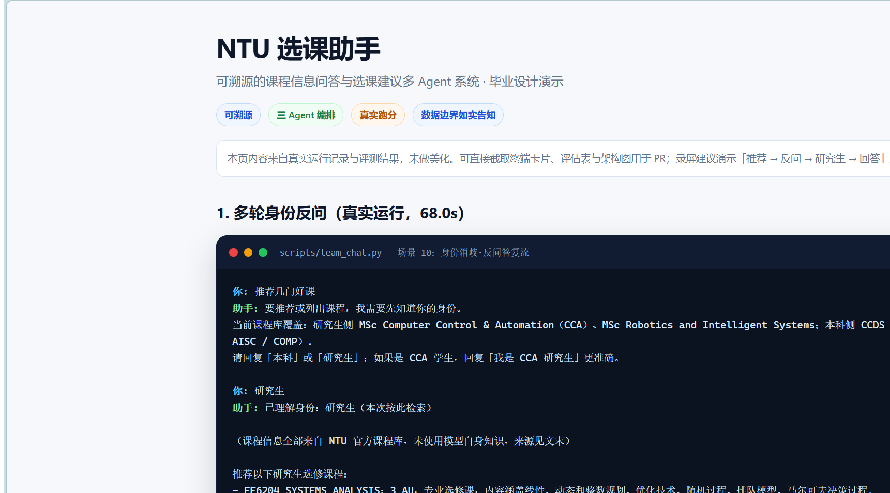

# NTU 选课助手

## 项目简介

面向南洋理工大学（NTU）学生的**可溯源课程信息问答与选课建议**多 Agent 系统。回答只依据官方课程数据，每条结论附来源；查不到就明说，不编造。

作者本人是 CCA 2027 春季入学新生，项目最初是为了核对课程 AU、先修、互斥与学位规则，避免被非官方信息误导。

> 毕业设计项目，基于 [hello-agents](https://github.com/datawhalechina/hello-agents) 1.0.1（Datawhale 教程）。不做自动选课/抢课，不做全学位路径优化。

## 技术栈

Python 3.12 · hello-agents 1.0.1 · 智谱 glm-4-flash / embedding-3 · SQLite + BM25 + RRF · mcp 2.3.0

## 能做什么

- **课程属性查询**：AU、开课学期、先修、互斥、课程简介、所属项目
- **项目课程列表**：本科 CSC / CE / DSAI / AISC / COMP；研究生 CCA、Robotics and Intelligent Systems
- **学位规则校验**：CCA Option 1 专选门数 ≥4、通选 AU 上限 18、先修/互斥提示
- **课表冲突检测**：仅有官方课表数据的课程（CSC 本科 2026 Sem 1）
- **身份识别与反问**：不确定本科/研究生时先反问；跨项目身份切换不沿用旧缓存
- **边界如实告知**：库外专业/课码直接说明未收录，不给相近课程硬答
- **MCP 能力外放**：外部 Agent/IDE 可通过 MCP 查询课程库与学位规则

## 快速开始

### 1. 环境

- Python 3.12
- [uv](https://docs.astral.sh/uv/)（项目用 uv 管理环境）
- 智谱 API Key（<https://open.bigmodel.cn/>）

```powershell
# 在 hello-agents 仓库内
cd Co-creation-projects/YounglWei-NTUCourseAdvisor

# 独立仓库使用时，路径替换为你自己的克隆目录
uv venv --python 3.12
.venv\Scripts\activate
uv pip install -r requirements.txt
# 也可直接：pip install -r requirements.txt
```

### 2. 配置

在项目根新建 `.env`（已被 `.gitignore` 忽略，不要提交）：

```env
ZHIPU_API_KEY=your_key_here
ZHIPU_BASE_URL=https://open.bigmodel.cn/api/paas/v4/
ZHIPU_MODEL=glm-4-flash
EMBEDDING_MODEL=embedding-3
```

### 3. 构建索引

`data/course_cards.jsonl`（201 张卡）已随仓库提供；`data/rag.db` 与向量缓存是派生文件，已被 gitignore，首次运行需重建：

```powershell
# 可选：从原始抓取数据重新生成课程卡片
python scripts/build_cards.py

# 必做：构建 RAGStore（BM25）+ embedding-2/3 向量缓存
python scripts/build_index.py
```

### 4. 运行

```powershell
# 三 Agent 交互（推荐 demo 入口）
python scripts/team_chat.py

# 三 Agent 自测（11 个场景，含身份反问、校验工具）
python scripts/team_chat.py --selftest

# D2 单 Agent 交互（对照用）
python scripts/agent_chat.py

# MCP 能力外放演示
python scripts/mcp_demo.py
```

交互中输入 `q` 退出。

### 5. 评测

```powershell
# 检索层金标：BM25 / 向量 / hybrid 对比
python scripts/eval_retrieval.py

# 端到端 20 条（v1 预注册判据）
python scripts/eval_e2e.py

# 端到端 20 条（v2：列表类判据修订）
python scripts/eval_e2e.py --set eval/e2e_queries_v2.json
```

## 建议体验的问题

| 目的 | 输入 |
|---|---|
| 属性查询 | `SC2001 是几 AU？哪些学期开课？` |
| 项目列表 | `我是 CCA 研究生，课程列表有哪些？` |
| 身份反问 | `推荐几门好课` → 再答 `研究生` |
| 身份切换 | 先问 `我是 CCA 研究生，推荐机器学习方向的课`，再问 `我是 CSC 本科生，推荐机器学习方向的课` |
| 库外专业 | `我是 AAI 研究生，有哪些课程？` |
| 库外课码 | `CS1010S 这门课讲什么？` |
| 空描述字段 | `MA6210 讲什么内容？` |
| 学位规则 | `我是 CCA 研究生，已选 EE6203、EE6204、EE6221 三门专选，满足 Option 1 吗？` |
| 时间冲突 | `我是 CSC 本科生，SC1301 和 SC2301 时间冲突吗？` |

验收时重点看：**来源是否真实、查不到是否明说、边界是否给覆盖清单、身份是否反问/正确切换、学位规则是否引用官方规则页**。

## 演示效果



- [完整演示页](docs/screenshots/cli-demo.html)：多轮身份反问、属性查询、边界场景、评测表与架构图。
- [架构图](docs/screenshots/architecture.svg)
- [评测结果图](docs/screenshots/eval-results.svg)

> 截图来自本地浏览器渲染的真实运行记录；录屏建议演示「推荐 → 反问 → 研究生 → 回答」这一条链路。

## 架构

```
用户原话 + 完整对话历史
        │
        ▼
┌─────────────────────────────────────────────┐
│ Planner（LLM + function calling）            │
│ 产出 steps + assumed_identity               │
│ （level / programme / confidence）           │
└─────────────────────────────────────────────┘
        │  过滤型代码护栏（不改写用户输入）
        │  · 层次未知 → 反问
        │  · 库外项目 → 覆盖清单，不检索
        │  · 单课属性查询忽略身份
        ▼
┌─────────────────────────────────────────────┐
│ Retrieval（ReActAgent，多步工具调用）        │
│  rag_search（BM25 ⊕ 向量，RRF）              │
│  check_schedule_conflict / specialized /    │
│  au_limit / prerequisites                   │
└─────────────────────────────────────────────┘
        │
        ▼
┌─────────────────────────────────────────────┐
│ Polish（单轮精炼）                           │
│ 推荐类补组合逻辑总述；普通问答整理成文        │
└─────────────────────────────────────────────┘
        │
        ▼
┌─────────────────────────────────────────────┐
│ Reviewer（Reflection ≤3 轮，双轨）            │
│  机械审查：来源覆盖/真实性/字段/空描述/完整性 │
│  LLM 审查：语义、越权、猜测兜底               │
│  任一 FAIL → 打回 Retrieval 修订              │
└─────────────────────────────────────────────┘
        │
        ▼
   回答 + 来源清单
```

### 三个 Agent 的职责

| Agent | 实现 | 职责 |
|---|---|---|
| Planner | `generate_plan` function calling（`src/team.py`） | 理解问题与身份，产出检索/校验计划 |
| Retrieval | `ReActAgent` + `ToolRegistry`（`src/team.py`） | 按计划调工具，产出有来源的草稿 |
| Reviewer | `SimpleAgent` + 机械审查（`src/team.py` + `src/guards.py`） | 双轨审查，失败打回修订 |

### 检索层

- 一门课一张卡，一卡一个 chunk（不切片），`document_id=course_code`
- BM25（`RAGStore`）与向量余弦（智谱 `embedding-3`）各自排名，用 RRF 融合（`1/(rrf_k+rank)`）
- `ExactCodeGuard`：query 含课码而结果无该码时返回空，避免相近课张冠李戴
- `level` / `programme` 确定性过滤：本科按 Curricula 行、研究生按 Programme 行；专业内主科课码（SC/CT/EE）优先

## 数据覆盖与边界

| 项 | 现状 |
|---|---|
| 课程卡片总数 | **201 张**：本科 156 + 研究生 45 |
| 本科 | 仅 CCDS 学院 5 个专业：CSC / CE / DSAI / AISC / COMP |
| 研究生 | MSc Computer Control & Automation（CCA）32 门；MSc Robotics and Intelligent Systems 13 门 |
| 数据源 | WIS 本科目录（2026 Sem 1/2）、NTU 官网 CCA 项目页、NTU 官网 Robotics 项目页、WIS 课表（CSC Y1 2026 Sem 1） |
| 来源粒度 | 本科 156 门的 `source_url` 为 WIS 课程目录入口页（非逐课永久链接）；研究生为项目页 |
| 课表冲突 | 仅有课表数据的课程可检测；**研究生课表官方不公开** |
| Robotics 简介 | 13 门均无 description（项目页只有 3 列表格）；回答会明说“简介未收录” |
| 授课教师 | WIS 课表不提供 INSTRUCTOR 字段 |
| 库外专业 | 直接给覆盖清单，不检索、不拿相近课程硬答 |

> 课程数据版权归 NTU，每张卡片保留官方 `source_url`；本项目仅用于学习/毕业设计。

## 评测结果（真实跑分）

### 检索层（15 条金标，201 卡）

| 方案 | recall@5 | MRR@5 | nDCG@5 |
|---|---|---|---|
| BM25 | 0.533 | 0.500 | 0.488 |
| 向量 embedding-2 | 0.678 | 0.639 | 0.638 |
| 向量 embedding-3 | 0.833 | 0.767 | 0.770 |
| **hybrid embedding-3** | **1.000** | **0.878** | **0.887** |

### 端到端（20 条，五类问题）

| 版本 | 判据 | 准确率 | 单轮中位 | P90 |
|---|---|---|---|---|
| D4 基线 | v1 预注册 | 12/20 = 60.0% | 28.01s | 61.03s |
| D4.1 修复 | v1 预注册 | 17/20 = 85.0% | 25.44s | 72.73s |
| D4.2 判据修订 | v2 | **19/20 = 95.0%** | 33.41s | 105.95s |

- **v1 与 v2 不可直接比较**：v2 只把列表类 Q06/Q07/Q08 的固定锚点改为结构判据（≥3 门、层次一致、项目归属一致、来源合法），其余 17 条不变。v1 保留在 `eval/e2e_queries.json`，v2 在 `eval/e2e_queries_v2.json`。
- D4.2 唯一 FAIL 是 Q16（MA6210 空描述单次未明说“简介未收录”）；已加代码护栏，定向复跑 PASS，但未再重跑全量。
- 完整逐条结果与归因见 [04-评估报告.md](04-评估报告.md)。

## hello-agents 框架映射

| 教程概念 | 框架源码（1.0.1） | 本项目用法 |
|---|---|---|
| ReAct | `agents/react_agent.py` + `core/runtime.py`（`turn_events` 工具循环） | Retrieval 阶段 `ReActAgent` 调工具 |
| 工具调用 | `tools/base.py`（`@tool_action`）、`tools/registry.py`、`core/llm.py`（`invoke_with_tools`） | `CourseRAGTool` + `DegreeAuditTool`（4 个子工具） |
| Reflection | `agents/reflection_agent.py`（执行→反思→修订） | Reviewer 循环 ≤3 轮；机械审查 + LLM 审查双轨（未直接实例化 `ReflectionAgent`） |
| Plan & Solve | `agents/plan_solve_agent.py`（Planner + Executor） | Planner 用 `generate_plan` function calling；不被框架的 PlanSolveAgent 限制 |
| RAG | `retrieval/store.py`（`RAGStore`）、`retrieval/hybrid.py`（`HybridSearch` RRF） | 课程卡片 → BM25 ⊕ 向量 → RRF |
| MCP | `tools/mcp.py`（`MCPConnection.stdio`） | `scripts/mcp_server.py` 暴露 5 个工具；主流程不挂载（能力外放） |
| 评估 | `retrieval/evaluation.py`（recall/MRR/nDCG） | `scripts/eval_retrieval.py` |

> 框架 **没有 `AgentTeam`**：1.0.1 的多 Agent 只是 `PlanSolveAgent` / `ReflectionAgent` 这类单 Agent 内部角色拆分。本项目的 `CourseAdvisorTeam` 是 Python 编排层，与框架官方模式同构。核实过程见 [05-架构说明.md](05-架构说明.md)。

## 项目结构

```
├── README.md
├── requirements.txt      # 依赖
├── main.ipynb            # 毕业设计 Demo
├── .env.example          # 环境变量示例
├── LICENSE
├── src/
│   ├── team.py          # 计划生成、三 Agent 编排、精炼、历史
│   ├── prompts.py       # 三份提示词 + Planner schema
│   ├── guards.py        # 机械审查、来源验真、字段核对、覆盖文案
│   ├── agent.py         # D2 ReAct 组装、CourseRAGTool、ExactCodeGuard
│   ├── identity.py      # 身份查表、项目 grounding
│   ├── validators.py    # DegreeAuditTool：课表冲突/专选/AU/先修互斥
│   ├── vector_store.py  # 智谱 embedding 后端 + 向量缓存
│   ├── cards.py         # 原始数据 → 课程卡片
│   └── config.py        # .env 与路径常量
├── scripts/
│   ├── team_chat.py     # 三 Agent 交互/自测
│   ├── agent_chat.py    # D2 单 Agent 交互/自测
│   ├── build_cards.py   # 构建课程卡片
│   ├── build_index.py   # 构建 RAGStore + 向量索引
│   ├── eval_retrieval.py# 检索金标跑分
│   ├── eval_e2e.py      # 端到端 20 条跑分
│   ├── mcp_server.py    # MCP server（5 工具）
│   └── mcp_demo.py      # MCP 链路演示
├── m0_spike/            # D0 数据源侦察与抓取脚本
├── data/                # 课程卡片、原始抓取数据、派生索引（rag.db/向量缓存已 gitignore）
├── eval/                # 金标 + 端到端判据 + 真实跑分结果
├── tests/               # 无 API key 的回归测试
├── docs/screenshots/    # 演示页、架构图、评测图、真实截图
├── requirements.md      # 需求正本
├── design.md            # 设计正本
├── decisions.md         # 决策流水
├── 04-评估报告.md       # D4 真实数字与失败归因
└── 05-架构说明.md       # 代码 ↔ 教程章节映射
```

## 项目亮点与设计取舍

1. **可溯源优先**：每条结论必须能追到官方 `source_url`；查不到明说，不用相近课程补。
2. **身份识别 = 模型理解 + 代码过滤**：不让代码替模型“理解身份”，也不让模型独自“判定身份”；代码只做过滤（层次未知反问、库外项目不许 certain、单课查询忽略身份）。
3. **对话历史透传**：最近 6 轮原话与回答进入 Planner/Retrieval；用户原话不截断，超长助手回答截断到 400 字。不做挂起态窄解析、不改写用户输入。
4. **A/B 判别实验**：曾把“写不出推荐组合逻辑”归因于模型上限，实验证明是信息流设计压制；修复是把精炼放到 ReAct 循环外，不是换模型。
5. **MCP 能力外放，不挂主流程**：主流程已有进程内工具，挂 MCP 只会多一层子进程往返；MCP 的价值是让外部程序复用课程库。
6. **判据先定死**：评测集判据跑分前固定；边界场景以“如实说未收录”为正确；数字必须真实。

## 已知限制

- `glm-4-flash` 免费档长响应/采样波动：完整跑分出现过 120s 级延迟与单次字段遗漏；已把 LLM 时限调到 240s 并加字段完整性护栏，但无法完全消除模型波动。
- Q16 在全量跑分中单次遗漏“课程简介未收录”；定向复跑 PASS，未重跑全量。
- Robotics 13 门无课程简介；本科仅 CCDS 学院；研究生课表官方不公开；WIS 不提供授课教师。
- 本科来源 URL 为 WIS 目录入口页，不是逐课永久链接；回答附课码，便于回目录检索。
- 英文提问偶尔回中文；来源链接标签文字偶尔不准（URL 本身正确）。
- 不做自动选课/抢课。

## 未来计划

- 扩展更多 MSc 项目课程（当前仅 CCA + Robotics）。
- 提升来源粒度：为每门课保存可定位的官方快照或带课码的查询链接。
- 增加 Web UI / 截图 / 录屏，降低体验门槛。
- 补自动化测试（身份查表、机械审查、学位校验回归）。

## 贡献指南

欢迎 Issue / PR。提交前请至少跑 `python -m unittest discover -s tests -t . -v`、`python -m src.identity` 和 `python -m src.validators`；改动检索/编排请补跑 `python scripts/team_chat.py --selftest`。新增数据必须保留官方 `source_url`，课程数据版权归 NTU。

## 文档

- [requirements.md](requirements.md) — 需求与验收标准
- [design.md](design.md) — 架构、Agent 划分、提示词与数据设计
- [decisions.md](decisions.md) — 决策流水
- [03-数据源侦察.md](03-数据源侦察.md) — 数据源与抓取过程
- [04-评估报告.md](04-评估报告.md) — 真实跑分与失败归因
- [05-架构说明.md](05-架构说明.md) — 代码 ↔ 教程章节映射

## 作者

- GitHub: [@YounglWei](https://github.com/YounglWei)
- 项目类型：学习辅助（毕业设计）

## 许可证

本项目采用 [CC BY-NC-SA 4.0](https://creativecommons.org/licenses/by-nc-sa/4.0/) 许可。课程数据版权归 Nanyang Technological University (NTU)，每张卡片保留官方 `source_url`；本项目仅用于学习/毕业设计，不主张对原始课程数据的所有权。

## 致谢

- [hello-agents](https://github.com/datawhalechina/hello-agents)（Datawhale）— 框架与教程
- 南洋理工大学官方课程目录、项目页与课表 — 数据来源
