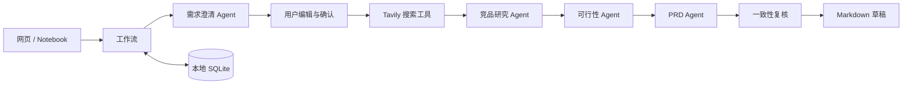

# 架构设计

## 技术选择

- Python 3.10+ 标准库提供本地 HTTP 服务、SQLite、后台线程及 Tavily HTTP 请求。
- HelloAgents 0.2.9 的 SimpleAgent 和 HelloAgentsLLM 连接 OpenAI 兼容模型。
- 原生 HTML / CSS / JavaScript 提供单页工作台，无 Node 构建依赖。
- 单进程、仅绑定 127.0.0.1。当前方案用于本机 Demo，不是面向公网的多租户服务。

## 模块与数据流

使用明确的顺序工作流。用户确认是独立步骤，不由模型代替。联网选项关闭或搜索失败时，明确记录缺少资料，然后继续处理已有需求。

### 代码职责

| 文件 | 职责 |
| --- | --- |
| main.py | 命令行启动，设置本地端口 |
| src/config.py | 设置加载、字段校验、脱敏的配置状态 |
| src/prompts.py | 角色规则与需求字段定义 |
| src/services.py | HelloAgents 调用、JSON 解析、真实 Tavily 搜索 |
| src/workflow.py | 访谈、确认、分析、复核、报告及 SQLite 保存 |
| src/server.py | REST 路由、后台任务、静态资源、导出 |
| web/ | 网页布局、交互和状态展示 |
| main.ipynb | 调用同一套工作流的交互式演示 |
| tests/ | 隔离外部服务的流程、接口、错误处理测试 |

## 状态与一致性

项目记录包含 idea、messages、brief、confirmed_brief、round、sources、competitors、assessment、prd、conflicts、report、stage、busy、error。

- messages 保存真实用户输入和模型回应，模型上下文由工作流显式传递。
- brief 是可编辑草稿；confirmed_brief 是用户确认后的深拷贝。
- 每次模型调用创建独立 SimpleAgent，避免全局角色历史跨项目泄漏。
- 生成流程只读 confirmed_brief；报告第一节直接由程序渲染确认内容，后续为建议。
- 修改确认需求时清空 sources、competitors、assessment、prd、conflicts、report，避免导出旧版本。
- 同一项目的变更受 busy 状态与服务器锁约束。不同项目可各自运行。
- SQLite 每次保存单条完整 JSON；后台步骤结束就保存。进程重启将残留 busy 标记恢复为可重试错误。

## API

| 方法 | 路径 | 行为 |
| --- | --- | --- |
| GET | /api/health | 返回模型、框架和搜索配置状态，不含密钥 |
| POST | /api/settings | 更新当前服务进程的设置；空密钥保留原值 |
| GET / POST | /api/projects | 列出最近项目 / 创建访谈 |
| GET | /api/projects/{id} | 获取进度及项目数据 |
| POST | /api/projects/{id}/answer | 保存回答并发起下一轮 |
| POST | /api/projects/{id}/confirm | 保存用户确认快照 |
| POST | /api/projects/{id}/reopen | 重新编辑，旧分析失效 |
| POST | /api/projects/{id}/generate | 研究、评估、编写、复核 |
| POST | /api/projects/{id}/retry | 重试失败阶段 |
| GET | /api/projects/{id}/export | 导出已生成 Markdown |

长任务在后台线程运行，前端轮询真实阶段；不使用虚构百分比。前端加载失败显示错误，已保存内容可重新打开。

## 连接与安全边界

连接信息可来自项目本地 .env 或设置面板。.env、数据库、输出、验证环境、截图与 taste-skill 临时文件都被 .gitignore 排除。

默认没有密钥，不调用模型，不生成假结果。网页保存的密钥仅存在服务端内存，响应不回传密钥。SDK 失败只返回通用错误，避免把第三方异常中的敏感信息传给浏览器。

生产模型适配器只有真实 HelloAgents 路径，没有测试模式。测试通过依赖注入使用替身。静态文件采用白名单，同源变更请求需 JSON 和固定请求头；页面使用 textContent 渲染模型文本，外部来源只允许 HTTP(S) 链接。

## 搜索与生成的限制

Tavily 返回最多六条搜索结果，竞品 Agent 从中整理最多三个产品。每条来源带编号、URL、摘录、UTC 查询时间。竞品引用了不存在的编号时移除该条，显示提示。

结构化结果会检查 JSON、关键字段、数组类型和数量。超时、认证失败或格式错误均结束当前任务并保留可重试状态。首版不承诺自动修复所有模型响应，也不将“引用编号存在”描述为事实正确性验证。

## 界面设计

按用户指定的 taste-skill，使用 white-link-blue 配色与 Funnel 字体搭配，中文回退到系统中文字体。页面以真实工作台为主体，保持左右齐边、克制的蓝色操作强调、可读的文档层级和键盘焦点。

任务是应用界面，不是营销首页，因此不加入多屏宣传章节、虚构客户、营销指标、Shader 背景或滚动场景。移动端将访谈与文档纵向排列。动画只用于进入和操作反馈，遵守减少动态效果设置。

