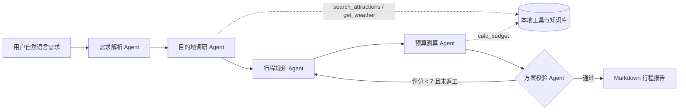

# AITravelPlanner：五智能体协作的 AI 旅行规划助手

> 输入「杭州 3 天 2 人 预算 3000 元 喜欢美食和博物馆」，输出一份含每日行程、天气提示与预算明细的完整旅行方案。

## 项目简介

**解决什么问题**

做一次旅行规划，通常要在多个 App 之间来回切换：查景点、看天气、算预算、排路线。信息分散、耗时，而且行程经常「排得太满」或「预算超标」。

**本项目做什么**

用 5 个职责单一的智能体把这件事拆开，按流水线协作：

| 智能体 | 职责 | 产出 |
|--------|------|------|
| 需求解析 Agent | 把自然语言需求转成结构化参数 | 城市 / 天数 / 人数 / 预算 / 偏好 |
| 目的地调研 Agent | 调用工具查景点与天气 | 候选景点列表 + 逐日天气 |
| 行程规划 Agent | 把候选景点排进每一天 | 每日上/下午/晚间安排 |
| 预算测算 Agent | 调用预算工具拆分费用 | 交通/住宿/餐饮/门票明细 |
| 方案校验 Agent | 检查行程强度与预算合理性 | 评分 + 问题清单（低于阈值触发返工） |

**和常见「一键生成攻略」的区别**

- 规划 Agent 之后还有**校验 Agent**：行程太赶、预算超支会被打回重排（最多返工 1 次，避免死循环）。
- 调研与预算**必须调用工具**拿数据，而不是让模型凭记忆编造票价和天气。
- 整个流程与真实上线的微信小程序版本**同源设计**（小程序版用 LangGraph 编排 5 个 Agent，本目录用 HelloAgents 框架重写为可独立运行的教学版，见 [完整项目](https://github.com/rz-123/path-planning-AI)）。

## 系统架构



> 编排方式是**顺序流水线 + 单次条件返工**，不是自由对话式多智能体。好处是每一步的输入输出都能用 JSON 校验，出错时容易定位是哪个环节的问题。

## 核心功能

- [x] 自然语言需求解析（兼容「3 天」「2 人」「预算 3000」等口语表达）
- [x] 景点知识库检索工具（覆盖杭州 / 成都 / 西安 3 座城市）
- [x] 天气查询工具（演示用确定性数据，无需外部 Key）
- [x] 预算拆分工具（交通 / 住宿 / 餐饮 / 门票 / 其他）
- [x] 行程合理性校验与一次返工
- [x] 输出 Markdown 报告，可直接粘贴到笔记

## 技术栈

- **HelloAgents 框架**：`SimpleAgent` 承担单个智能体，`Tool` / `ToolParameter` 封装工具
- **智能体范式**：Plan-and-Solve（先规划再执行）+ Reflection（校验返工）
- **LLM**：任意 OpenAI 兼容接口（DeepSeek / ModelScope / 通义 / OpenAI），由 `HelloAgentsLLM` 读取环境变量
- **数据**：`data/attractions.json` 本地景点知识库（含门票、建议游玩时长）

## 快速开始

### 环境要求

- Python 3.10+
- 一个可用的 OpenAI 兼容 LLM API Key

### 安装依赖

```bash
pip install -r requirements.txt
```

### 配置 API 密钥

```bash
# Windows PowerShell: Copy-Item .env.example .env
cp .env.example .env
```

编辑 `.env`：

```dotenv
LLM_MODEL_ID=deepseek-chat
LLM_API_KEY=你的密钥
LLM_BASE_URL=https://api.deepseek.com/v1
```

### 运行

```bash
jupyter lab
```

打开 `main.ipynb`，从上到下依次运行。

## 使用示例

```python
from src.pipeline import run_pipeline

result = run_pipeline("杭州 3 天 2 人，预算 3000 元，喜欢美食和博物馆")
print(result["report"])
```

输出结构：

```text
result = {
  "requirement": {"city": "杭州", "days": 3, "people": 2, "budget": 3000, "interests": [...]},
  "weather":     [{"date": "...", "condition": "晴", "temp_low": 15, "temp_high": 25}, ...],
  "plan":        [{"day": 1, "morning": "...", "afternoon": "...", "evening": "..."}, ...],
  "budget":      {"transport": ..., "hotel": ..., "food": ..., "tickets": ..., "total": ...},
  "review":      {"score": 8, "issues": [...], "suggestions": [...]},
  "report":      "# 杭州 3 日行程 ..."
}
```

## 实际运行结果（节选）

环境：Python 3.12 + `hello-agents 1.0.1` + `deepseek-chat`。输入「杭州 3 天 2 人，预算 3000 元，喜欢美食和博物馆」：

```markdown
# 杭州 3 日行程
- 出行人数：2 人
- 预算上限：3000 元
- 预计总花费：2690 元（人均 1345 元）

### Day 1
- 上午：灵隐寺（2.5 小时，建议早到避开人流）
- 下午：西湖（3 小时，断桥—白堤—苏堤步行环湖）
- 晚上：湖滨步行街自由晚餐/夜景

### Day 2
- 上午：浙江省博物馆（2 小时，免费预约，室内避雨）
- 下午：中国茶叶博物馆（1.5 小时，室内为主）
- 晚上：室内自由活动/休息

### Day 3
- 上午：西溪湿地（3 小时，摇橹船与芦苇荡慢逛）
- 下午：河坊街（2 小时，小吃与老街逛吃）

质检评分：8/10
```

校验 Agent 在真实运行中给出的问题包括「第 1 天西湖 3 小时偏紧」「门票预算偏低」「第 1/3 天缺少雨天备选」，说明校验环节确实在起作用，而不是走过场。

## 项目亮点

1. **工具优先，不让模型编数据**：天气、门票、游玩时长来自工具返回值，模型只负责组织与决策。
2. **有校验闭环**：多数同类 Demo 生成即结束；这里用评分阈值触发一次返工，能挡住「一天排 5 个景点」「预算超 30%」这类常见问题。
3. **结构化中间态**：每一步都要求 JSON，解析失败有兜底，链路上任何一步都能单独复现调试。
4. **可对照真实工程**：同一套 5 Agent 设计已在微信小程序 + FastAPI 项目中落地（[path-planning-AI](https://github.com/rz-123/path-planning-AI)），本目录是剥离框架依赖后的可教学版本。

## 局限说明

- 天气为**确定性演示数据**（按城市+日期哈希生成），不是实时天气；真实项目接的是高德 MCP。
- 景点库只覆盖 3 座城市，扩展方式见 `data/attractions.json`。
- 未接入真实地图路径规划，天与天之间不做交通时长约束。

## 未来计划

- [ ] 接入高德地图 MCP，替换演示天气与静态景点库
- [ ] 引入真实路径耗时，约束每日行程上限
- [ ] 把返工次数与校验评分做成可配置策略
- [ ] 增加多城市串联（如「杭州 → 乌镇」）

## 作者

- GitHub: [@rz-123](https://github.com/rz-123)
- 完整项目: [rz-123/path-planning-AI](https://github.com/rz-123/path-planning-AI)

## 致谢

感谢 Datawhale 社区与 Hello-Agents 教程。
