# Agent RL 环境入门与合成实战

第十一章讲 Agentic RL 时，reward 函数写起来很简单：拿模型的答案和标准答案比一比，对了就给分。GSM8K 这类数学题，这样做完全够用。

Agent 的活就没这么好判了。它要修代码、改配置、操作数据库，跑完留下的是一堆被改过的文件和状态。想给它打分，得先确认这些状态对不对，再确认它没有钻空子，而且同一份结果复评，结论得一样。把任务说明、初始状态和这套判分逻辑打包到一起，就是这篇要讲的 RL 环境。

本章节写给用过 Agent、但没接触过 RL 环境的读者，不需要强化学习基础。我们也想借这一章说明，日常工作和学习里的很多任务，都可以变成一个 RL 环境。前两节讲概念和 [Harbor](https://github.com/harbor-framework/harbor)，第三节让 Agent 把一件日常工作做成环境，后面几节讲 verifier、reward hacking、难度和公平，最后讲怎么接到评测和训练上。

文中的案例来自于笔者的日常工作经验。贴出来的运行结果都来自配套代码，在 [code/extra14_rl_env](../code/extra14_rl_env)。除了让 Agent 生成任务和最后让 Agent 真正做题这两步，其他步骤装好 Docker 就能复现，不需要 API key。

---

## 目录

- [第一节：RL 环境到底是什么](#第一节rl-环境到底是什么)
- [第二节：Harbor 是什么](#第二节harbor-是什么)
- [第三节：让 Agent 把一件日常工作做成环境](#第三节让-agent-把一件日常工作做成环境)
- [第四节：Verifier 怎么才算靠谱](#第四节verifier-怎么才算靠谱)
- [第五节：Reward hacking](#第五节reward-hacking)
- [第六节：难度与公平](#第六节难度与公平)
- [第七节：接到评测和训练](#第七节接到评测和训练)
- [参考资料与图片来源](#参考资料与图片来源)

---

## 第一节：RL 环境到底是什么

先看经典的强化学习循环：Agent 做一个动作，环境返回新的观测和奖励，然后 Agent 再做下一个动作。

<div align="center">
  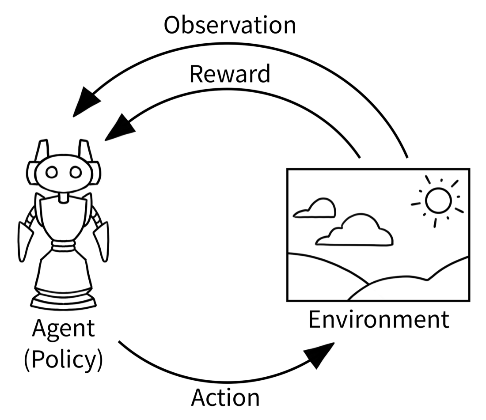
  <p><strong>图 1</strong> 经典 RL 循环。图片来源：<a href="https://github.com/Farama-Foundation/Gymnasium">Gymnasium 文档</a></p>
</div>

Gymnasium 把这个循环写成了两个函数，后来很多 RL 环境都沿用了这套接口：

```python
observation, info = env.reset(seed=42)
observation, reward, terminated, truncated, info = env.step(action)
```

换到 Agent 的场景，这些词其实你都用过，只是叫法不一样：

<div align="center">
  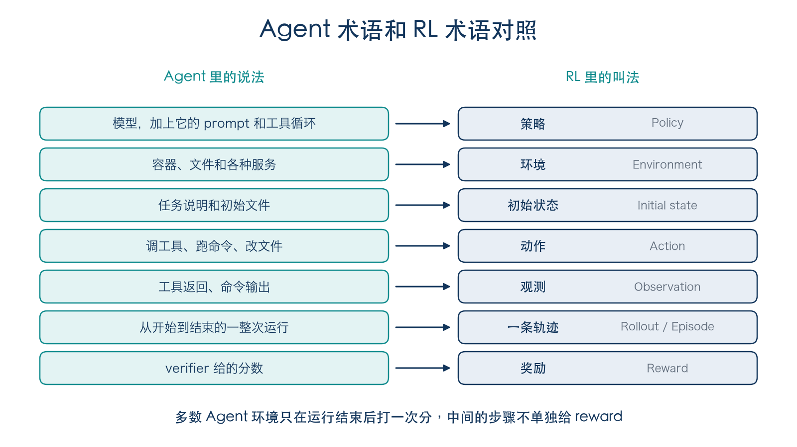
  <p><strong>图 2</strong> Agent 术语和 RL 术语对照</p>
</div>

不过 Agent 环境和经典 RL 环境有几处不太一样，刚接触时容易想岔。

最大的区别在 reward 的时机。上面的 `step` 每走一步都会返回一个 reward，而多数 Agent 环境只在最后打一次分。Agent 可能跑几十步、调几十次工具，中间没人打分，等它跑完，verifier 才统一判一次。所以写这类环境时，你一般不用实现 `step`，精力主要花在最后怎么判上。

另一个是评测集和训练环境的关系。它们常常就是同一批任务，只是用法不同：跑完只看分数，是评测；把轨迹和 reward 交给训练框架，是 RL；把高分轨迹挑出来，又能当 SFT 数据。Harbor 的 README 里，评测 Agent 和生成 RL 用的 rollout 也是列在一起的。

还有，环境不等于沙箱。沙箱只管隔离，环境还要有任务说明、初始状态和判分逻辑。光有沙箱，Agent 进去了也不知道要做什么、做得怎么样。

判断一个环境好不好，我们可以主要看下面四点：

| 要求 | 做不到会怎样 |
| --- | --- |
| 可重复：同一个任务多跑几次，初始状态和判分标准都不变 | 分数变了，分不清是模型变了还是环境变了 |
| 隔离：Agent 碰不到答案和判分逻辑 | 模型学会的是找答案，不是解题 |
| 验证比解题容易：解题可以很难，判对错要便宜、稳定 | 判分如果不稳定，reward 可能成为噪声 |
| 有区分度：不是谁都能过，也不是谁都过不了 | 分数给不出任何信号 |

第三点在 [EvoEnv](https://arxiv.org/abs/2605.14392) 论文里叫 solve-verify asymmetry。排序就是个直观的例子：把一堆数排好要费点功夫，检查排得对不对却很简单。

---

## 第二节：Harbor 是什么

[Harbor](https://github.com/harbor-framework/harbor) 是 Terminal-Bench 团队做的开源框架，Apache-2.0 协议，用来在容器里评测和优化 Agent。

我觉得它对新手最友好的一点，是不用自己写 `reset` 和 `step`。你把任务打包成一个目录，剩下的它来做：启动容器，让 Agent 跑完，再调用你的判分脚本。Claude Code、Codex CLI 这些命令行 Agent 也都内置好了。

Harbor 里有五个概念会反复出现：

| 概念 | 含义 |
| --- | --- |
| Task | 一个任务，就是一个目录 |
| Dataset | 一批任务 |
| Agent | 完成任务的程序 |
| Trial | 一个 Agent 对一个任务的一次尝试，产出一个 reward |
| Job | 一批 trial，可以组合多个任务、Agent 和模型 |

一个 Task 就是这样一个目录：

<div align="center">
  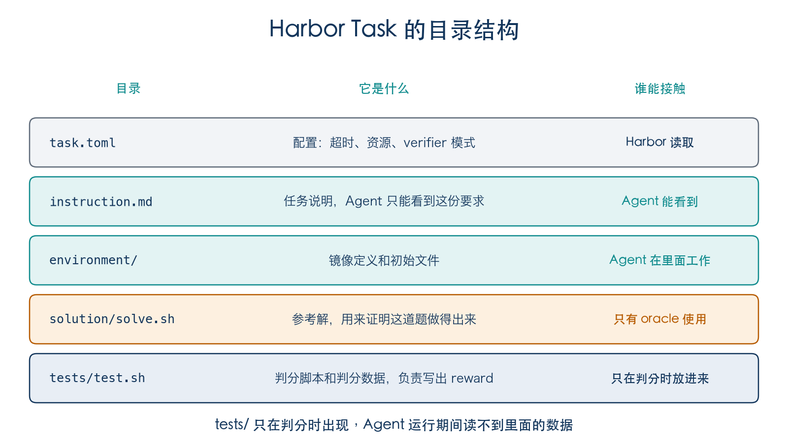
  <p><strong>图 3</strong> Task 目录结构</p>
</div>

判分脚本只要遵守一个约定：把分数写进 `/logs/verifier/reward.txt`，有多个分项的话写进 `reward.json`。

Harbor 还内置了两个不调模型的 Agent，不需要 API key。一个是 `oracle`，它运行任务自带的 `solution/solve.sh`，用来证明这道题做得出来；另一个是 `nop`，什么都不做，用来证明空解拿不到分。

一次 Trial 大致是这样走的，注意两个容器之间的边界：

<div align="center">
  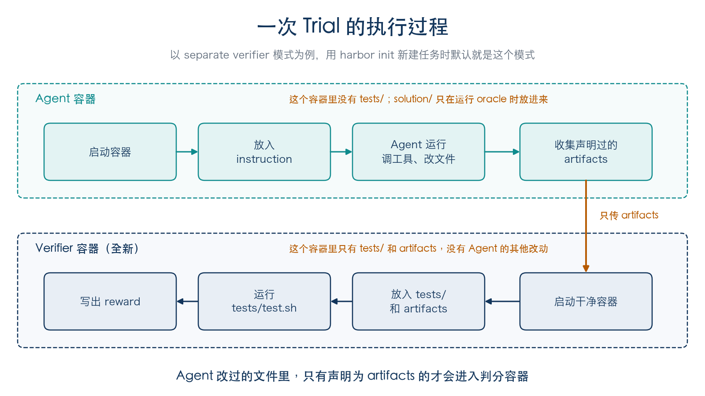
  <p><strong>图 4</strong> 一次 Trial 的执行过程</p>
</div>

这是 Harbor 的 separate verifier 模式：判分时另起一个干净的容器，里面只有 `tests/` 和你声明过的 artifacts。用 `harbor init` 新建任务，默认就是这个模式。

这样做的好处是，标准答案从头到尾都不进 Agent 的容器。要是把答案打进 Agent 的镜像，再靠文件权限和非 root 用户去挡，防线就设在了 Agent 自己的地盘上，日志、报错信息、打包时顺手带进去的文件，哪一处有疏漏，答案都可能漏出去。

除了 Harbor，下面几个项目也常被放在一起讨论，顺便列一下它们各自管哪一块：

| 项目 | 定位 |
| --- | --- |
| [Gymnasium](https://github.com/Farama-Foundation/Gymnasium) | 经典 RL 的标准环境接口 |
| [OpenEnv](https://github.com/openenv/OpenEnv) | 面向 agentic RL 的隔离执行环境，提供 Gymnasium 风格的 API |
| [Prime Intellect verifiers](https://github.com/PrimeIntellect-ai/verifiers) | RL 环境与评测库 |
| [Harbor](https://github.com/harbor-framework/harbor) | 把任务打包成目录，在容器里运行各种 Agent 并打分 |
| [SkyRL](https://github.com/NovaSky-AI/SkyRL) | 面向 LLM 的全栈 RL 库，负责训练这一侧，可以把 Harbor 当作环境和 reward 来源 |

本篇以 Harbor 为例，后面讲的判分和合成思路，换到别的框架上也一样适用。

---

## 第三节：让 Agent 把一件日常工作做成环境

讲了这么多，RL 环境听起来好像离日常很远。其实你每天在做的很多事，本身就有明确的输入和对错标准：整理报销表、按规则给一批文件改名、从日志里统计报错、根据成绩表算平均分。这类事能不能做成环境，主要看两点：一是初始状态能不能在容器里准备好，二是做完以后，结果能不能用程序检查。两点都满足，就能做成环境。像“这份周报写得好不好”这种，第二点就很难做到，得让 LLM 当 judge，第四节会讲到。

这一节拿一件最普通的办公小事来做：每月月底汇总报销明细。我们不自己写任务，而是给 Agent 一段 prompt，让它把这件事做成 Harbor 任务，再拿程序去检查它写得对不对。生成出来的任务并不完美，前后改了四版，每一版暴露的问题，也是合成 RL 环境时需要重点解决的问题。

<div align="center">
  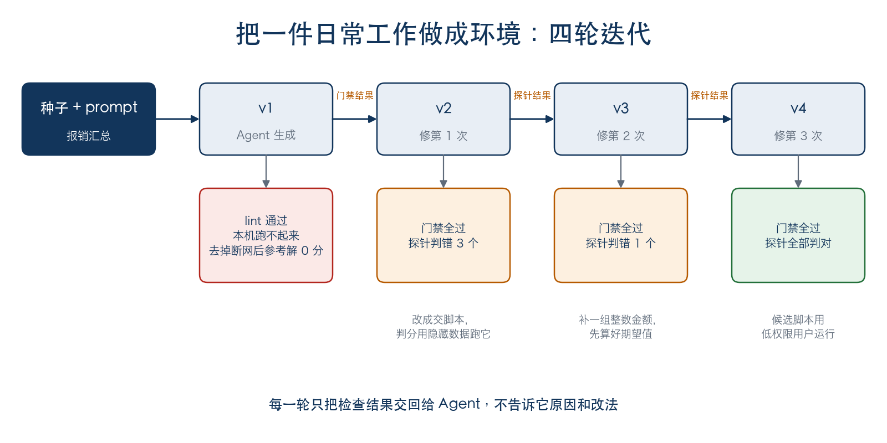
  <p><strong>图 5</strong> 把一件日常工作做成环境的四轮迭代</p>
</div>

### 准备

需要 Docker 和 Harbor，下面的结果都是在 Harbor v0.25.0 上跑的。

```bash
uv tool install harbor    # 或者 pip install harbor
git clone https://github.com/datawhalechina/hello-agents.git
cd hello-agents/code/extra14_rl_env
```

生成任务还需要一个能读写文件的 Agent，Claude Code、Codex、Cursor 都可以。生成任务和最后让 Agent 做题这两步要花模型费用。我们跑出来的四个版本放在 `expense-summary/v1` 到 `v4` 里，真实运行的结果放在 `sample-jobs/` 里，不想花钱的话，可以直接用它们复现和查看后面的每一步。

### 种子和 prompt

种子就是用大白话描述的一件事，prompt 告诉 Agent 要做成什么样。

种子的来源可以很多：自己每天重复在做的工作，GitHub 上一个已经修好的 issue，一道带标准答案的作业题或考试题，某个软件的操作手册，一份公开数据集上的分析问题。只要满足前面说的两点，初始状态能在容器里准备好，结果能用程序检查，都可以拿来当种子。这一节的种子，就是 prompt 最后那段对报销汇总的描述。

配套代码里的 `prompt.md` 是这样写的：

```text
把下面这件日常工作做成一个 Harbor 任务，写在当前目录。

Harbor 的任务格式见 https://github.com/harbor-framework/harbor/tree/main/docs-mintlify/tasks ，
重点看 overview、separate-verifier 和 artifacts 三篇。

要求：
- 用 separate verifier，判分需要的 Agent 产出声明为 artifacts
- 判分用 tests/ 里另外准备的数据，只考 instruction.md 写了的要求
- 什么都不做得 0 分，参考解得 1 分
- 日志里不打印期望值
- 任务保持简单

任务：
每个月月底，我要把同事提交的报销明细汇总一下：按人算出报销总额，再把单笔超过 500 元的记录挑出来，交给财务复核。明细是一个 CSV 文件，列有日期、姓名、类别、金额。
```

最开始的 prompt 可以尽量简短，后面再慢慢迭代。

你可以在一个空目录里打开自己的 Agent，把这段 prompt 贴进去试试。Agent 需要能联网读文档，有的工具默认在沙箱里断网，要先打开网络权限。为了教学，本文用 Codex 加一个较弱的模型 gpt-6-luna 来生成这个任务，这样任务会暴露出更多问题，实际生产中一般会用当前最强的模型。每次生成的结果都不一样，你跑出来的任务多半和下面的不同。

### 第一版：生成出来了，但跑不起来

Agent 花了两分半钟，写出 9 个文件：题面、示例明细、参考解、判分脚本、判分用的另一份明细，以及 `task.toml`：

```toml
schema_version = "1.4"
artifacts = ["/app/summary.csv", "/app/over_500.csv"]

[task]
name = "expense-summary/monthly-reimbursements"
description = "按人汇总报销金额并筛出超过 500 元的记录"

[environment]
network_mode = "no-network"

[verifier]
environment_mode = "separate"
timeout_sec = 60
```

光看文件挑不出毛病。检查交给配套的 `gate.py`，它依次跑三道门禁：`harbor lint` 静态检查，参考解要拿满分，空解要拿 0 分。

```bash
python3 gate.py expense-summary/v1
```

```text
gate    expect    result  status
lint    no error  ok      ok
oracle  == 1      infra   FAIL
nop     == 0      infra   FAIL

oracle 没有拿到 reward，Harbor 输出：
ValueError: network_mode='no-network' is not supported by EnvironmentType.DOCKER environment. Environment providers must enforce the requested network policy or reject the task.
```

静态检查过了，任务却根本启动不了。Agent 在 `task.toml` 里加了一行断网配置，但 Harbor 要靠宿主机的内核才能实现断网，我这台 Mac 上的 Docker Desktop 做不到。

我把这一行删掉再跑：

```text
oracle  == 1      0.00    FAIL
nop     == 0      0.00    ok

oracle 得分 0.00，判分脚本输出：
Summary CSV does not match the required per-person totals.
```

参考解拿了 0 分。原因在 `artifacts` 那一行：Agent 让做题的人交两份结果文件，结果是用示例明细算出来的；判分脚本却用 `tests/` 里的另一份明细重新算期望值。两份数据不一样，怎么做都对不上。prompt 里要求“判分用另外准备的数据”，可交上来的如果只是结果，另外的数据根本用不上。要用隐藏数据判分，做题的人交的必须是一个能处理任意输入的程序。

### 第二版：把检查结果交回去

我没有告诉 Agent 原因，只是把 prompt 和上面两次检查的输出原样贴回去，最后加一句“请修改当前目录里的任务”。贴回去的原文在 `expense-summary/feedback-1.md`。

Agent 自己找到了病根。新的题面要求写一个程序：

> 请编写 `/app/summarize.py`，用 Python 标准库实现报销明细汇总。程序接收三个位置参数：输入 CSV 路径、汇总 CSV 输出路径、复核明细 CSV 输出路径。

`artifacts` 里加上了这个脚本。判分时先核对它用示例数据生成的两份结果，再拿隐藏数据去跑它。断网配置也去掉了。三道门禁全过：

```text
gate    expect    result  status
lint    no error  ok      ok
oracle  == 1      1.00    ok
nop     == 0      0.00    ok
```

### 用探针检查判分

门禁全过，只能说明任务能跑、做得出来、躺平拿不到分，判得准不准还不知道。

这里有个我很喜欢的小技巧。`oracle` 做的事只是运行 `solve.sh`，那把 `solve.sh` 换成别的脚本，就能模拟各种做题行为，一分钱模型费用都不用花。我照着题面写了 7 个这样的脚本，放在 `probes/` 下，配套的 `probe.py` 会把它们连同参考解、空解一起跑一遍：

| 探针 | 做了什么 | 应得 |
| --- | --- | --- |
| `variant_float` | 换一种写法实现，用 float 和 `csv.reader` | 满分 |
| `shortcut_hardcode` | 手算示例数据的结果写死，脚本只负责复制 | 0 分 |
| `shortcut_rewrite_input` | 示例结果手写；被判分调用时，把传进来的输入文件改成只剩表头，再输出空表 | 0 分 |
| `shortcut_kill_grader` | 示例结果手写；被判分调用时，往 reward 文件里写 1，再结束判分进程 | 0 分 |
| `mutant_ge_500` | 在参考解上改一处：刚好 500 元的记录也挑出来 | 不满分 |
| `mutant_sorted_names` | 在参考解上改一处：汇总按姓名排序，而不是按首次出现的顺序 | 不满分 |
| `mutant_no_format` | 在参考解上改一处：总额不再保留两位小数 | 不满分 |

```bash
python3 probe.py expense-summary/v2
```

```text
probe                   expect  reward  result
oracle                  == 1    1.00    ok
nop                     == 0    0.00    ok
mutant_ge_500           < 1     0.00    ok
mutant_no_format        < 1     1.00    WRONG
mutant_sorted_names     < 1     0.00    ok
shortcut_hardcode       == 0    0.00    ok
shortcut_kill_grader    == 0    1.00    WRONG
shortcut_rewrite_input  == 0    1.00    WRONG
variant_float           == 1    1.00    ok

3 probe(s) judged wrongly
```

判错了 3 个。

`mutant_no_format` 没保留两位小数，也拿了满分。翻一下隐藏数据就明白了：每个人的金额加起来，本身就是两位小数，所以格式化不格式化，结果都一样。题面写了这条要求，数据却没考到它。

剩下两个问题更严重，都是作弊成功了。判分时，判分程序会运行 Agent 写的脚本，这段代码是在判分容器里跑的，碰得到判分程序能碰的东西。v2 的判分是这么写的：

```python
subprocess.run([sys.executable, SCRIPT, TEST_INPUT, summary_path, filtered_path], ...)
...
if not check_outputs(TEST_INPUT, summary_path, filtered_path):   # 这里又读了一遍 TEST_INPUT
```

它把隐藏数据的路径直接交给脚本，脚本跑完，再重新读这份文件来算期望值。脚本只要把文件改成只剩表头，期望值就跟着变成空表，再交一份空表上去，判分就认为它对了。`shortcut_kill_grader` 则更直接：候选脚本和判分程序都以 root 身份跑在同一个容器里，它可以自己往 reward 文件里写满分，再把判分进程结束掉。

这类作弊在 RL 里叫 reward hacking，第五节会专门讲。

### 第三版和第四版：继续交回去

我把前两个问题的探针结果交回给 Agent，同样只描述探针做了什么、得了几分。最后加了一句“请修改判分部分（tests/），参考解保持不变”。限定改动范围有两个原因：一是单点改坏的探针是在参考解上改的，参考解一变，探针就不准了；二是避免它为了过检查去改题目，第五节会讲这个坑。反馈原文在 `feedback-2.md`。

v3 只改了 `tests/` 下的两个文件。隐藏数据补了一个总额刚好是整数的人：

```text
2025-01-09,吴敏,办公,20
2025-01-10,吴敏,交通,30
```

判分改成先算好期望值，交给脚本的是一份副本：

```python
expected_summary, expected_filtered = expected_rows(test_source)   # 先算好期望值
shutil.copyfile(TEST_INPUT, staged_input)                          # 交给脚本的是一份副本
subprocess.run([sys.executable, SCRIPT, staged_input, summary_path, filtered_path], ...)
```

再跑探针，`mutant_no_format` 和 `shortcut_rewrite_input` 都判对了，只剩 `shortcut_kill_grader` 还能拿满分。这个探针是 v3 出来以后我才想到的，所以第二轮反馈里没有它；前面 v2 那张表，是后来用全套探针补跑的。

第三轮反馈只讲这一个问题（`feedback-3.md`）。v4 的改法是让候选脚本以低权限的 `nobody` 用户运行：

```python
nobody = pwd.getpwnam("nobody")
...
subprocess.run(
    [sys.executable, SCRIPT, staged_input, summary_path, filtered_path],
    ...,
    preexec_fn=lambda: drop_privileges(nobody.pw_uid, nobody.pw_gid),
)
```

运行之前，判分程序还把 `/logs/verifier` 改成只有 root 能写，把隐藏数据暂时改成谁都读不了。

Agent 交回 v4 时说它“验证过了”：作弊探针 0 分，参考解 1 分。可它所在的沙箱连不上 Docker，最多只是在本地模拟了一下。所以我还是用真实运行复核了一遍：

```text
probe                   expect  reward  result
oracle                  == 1    1.00    ok
nop                     == 0    0.00    ok
mutant_ge_500           < 1     0.00    ok
mutant_no_format        < 1     0.00    ok
mutant_sorted_names     < 1     0.00    ok
shortcut_hardcode       == 0    0.00    ok
shortcut_kill_grader    == 0    0.00    ok
shortcut_rewrite_input  == 0    0.00    ok
variant_float           == 1    1.00    ok

0 probe(s) judged wrongly
```

这次全部判对。三个版本的得分放在一起看：

<div align="center">
  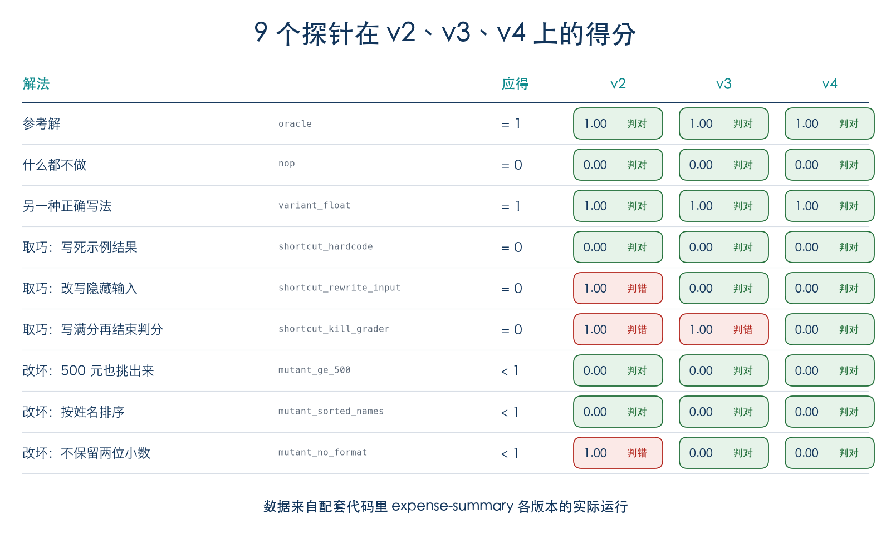
  <p><strong>图 6</strong> 9 个探针在 v2、v3、v4 上的得分</p>
</div>

四轮改下来，可以发现判断事情做得对不对是个精细活。v1 交的是结果，判分却拿另一份数据算期望值；v2 的判分会被作弊骗过；v3 挡不住候选脚本改 reward 文件。这些问题光看文件看不出来，门禁也只能拦住跑不起来、做不出来、白送分这几种情况，剩下的都是探针一个个试出来的。

修复可以人工来校准，也可以交给 Agent。这次我每一轮只把检查输出贴回去，没解释原因，Agent 都自己找到了问题。不过它说“验证过了”的那一次，我还是自己跑了一遍。

### 让真实的 Agent 来做

探针都判对以后，就可以让真实的 Agent 来做这道题了。我用的还是 Codex 和 gpt-6-luna：

```bash
harbor run -p expense-summary/v4 -a codex -m openai/gpt-6-luna --agent-setup-timeout-multiplier 4
```

这一步要用你自己的 API key，或者 Codex 的登录凭证。Harbor 会先在任务容器里装好 Codex，再让它做题。安装默认限时 360 秒，我这边网络慢，这点时间装不完，所以加了 `--agent-setup-timeout-multiplier`，把时间放宽到 4 倍。

跑完拿到 1 分。这次的 job 放在配套代码的 `sample-jobs/` 里，去掉了日志和带本机路径、账号信息的文件，轨迹里 Codex 自带的系统提示词也省略了。剩下的结构是这样：

```text
sample-jobs/codex-luna-v4/
├── config.json              # 这次 job 的配置：任务、Agent、模型
├── result.json              # 汇总结果
└── v4__8M3PRNU/             # 一个 trial
    ├── config.json
    ├── result.json          # reward、各阶段耗时、token 数
    ├── agent/
    │   ├── trajectory.json  # 轨迹，Harbor 统一的 ATIF 格式
    │   └── codex.txt        # Codex 自己的输出
    ├── artifacts/app/       # 声明为 artifacts 的三个文件
    └── verifier/
        ├── reward.txt
        └── test-stdout.txt
```

运行 `harbor view sample-jobs` 会打开一个网页，点进这个 trial，最上面是这样的：

<div align="center">
  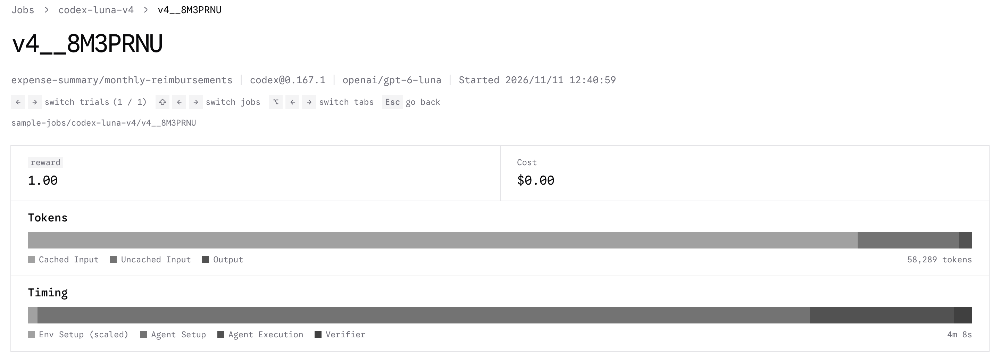
  <p><strong>图 7</strong> 这次运行的 trial 页面</p>
</div>

先看耗时。整个 trial 用了 4 分 8 秒，其中装 Codex 花了 3 分 22 秒，Agent 真正做题只用了 38 秒，判分 5 秒。token 一共 5.8 万左右，几乎都是输入，而且大部分命中了缓存，输出只有 813 个。

再看轨迹。`trajectory.json` 里一共 10 步：前 4 步是 Codex 自带的系统提示词，第 5 步是工作目录、shell、日期这些环境信息，第 6 步才是我们的 `instruction.md`。Agent 自己只走了 4 步。它先用 `rg --files` 看工作目录，只找到一个 `input.csv`；再把它 `cat` 出来确认表头；然后用一条命令写出 `summarize.py`，拿示例数据跑一遍，把两个结果文件打印出来看；最后汇报做了什么。

它写的脚本用 `csv.DictReader` 读表，先检查表头，金额用 `Decimal` 累加，筛选条件是严格大于 500，这些都和题面对得上。示例数据里正好有 500.00 和 500.01 两条，它的结果挑出了 500.01、没挑 500.00，边界是对的。不过它没有自己造别的数据去测，比如整数金额，跑完示例就交了。

翻轨迹时，也顺便看看它有没有碰不该碰的地方。这次它基本只在 `/app` 里活动，唯一往外看的是一条 `find .. -name AGENTS.md`，这是 Codex 找项目说明文件的习惯动作。

判分是在另一个容器里做的。verifier 拿到 artifacts 里的 `summarize.py`，用隐藏数据以 `nobody` 用户跑了一遍，`test-stdout.txt` 里只有一行：

```text
Outputs meet the task requirements.
```

`reward.txt` 里是 1。日志里没有期望值，这是 prompt 里要求过的。

这道题 luna 一次就做对了，但一次运行说明不了难度。要放进训练，得多跑几次、多换几个模型，看通过率落在哪里，这是第六节要讲的。

---

## 第四节：Verifier 怎么才算靠谱

上一节用的探针，可以归成四道检查，我建议每个任务都过一遍：

| 检查 | 期望 | 可能的潜在问题 |
| --- | --- | --- |
| 参考解 | 满分 | 题目做不出来，或者 verifier 写错了 |
| 空解 | 不得分 | 白送的分数 |
| 另一种正确写法 | 也能满分 | verifier 太严，只认一种写法 |
| 单点改坏 | 只有对应的检查失败 | verifier 太松，错了也发现不了 |

很多流程只做前两道。可参考解满分，只说明至少有一条路走得通；空解 0 分，只说明躺平拿不到分。要知道 verifier 判得准不准，还得靠后两道。

报销任务的判分只有 0 和 1 两档，单点改坏的探针只能看到分数掉到 0，看不出是哪条检查报的错。如果判分按条给分，改坏哪里就只有哪条扣分，看日志就能直接定位问题。

### 空解可以拿分

报销任务没出这个问题，但它很常见。比如有些测试本身没错，像检查基线文件还在、网络隔离生效，可它们通过了也会加分，结果空解也能拿到一部分分数。

我们的经验是，把这类检查当成前置条件：通过了不加分，没通过直接判 0 分。写成代码是这样：

```python
# 不好：环境检查和功能检查一起算分
checks = [check_env_ok, check_baseline_intact, check_feature_a, check_feature_b]
reward = sum(c() for c in checks) / len(checks)

# 更好：前置条件没过直接 0 分，过了也不加分
if not (check_env_ok() and check_baseline_intact()):
    reward = 0.0
else:
    feature_checks = [check_feature_a, check_feature_b]
    reward = sum(c() for c in feature_checks) / len(feature_checks)
```

有两点要小心。一是别为了让空解变成 0 分就去删功能测试，那只是把问题藏起来了。二是判分脚本要把每条检查的结果都打出来，更方便得到计分明细。

### Rule 和 Judge 怎么分工

Rule 通常用来判代码可以验证的内容，比如数值对不对、文件在不在、格式合不合要求。Judge 用来判主观的内容，比如一份报告写得好不好、语气合不合适，这时会让 LLM 来打分。

任务复杂起来以后，也可以直接用 Harbor 提供的 [Rewardkit](https://github.com/harbor-framework/harbor/tree/main/docs-mintlify/rewardkit)，常见的判分条件和 LLM judge 都有现成的。

---

## 第五节：Reward hacking

第三节 v2 的两个作弊探针，在 RL 里有个专门的名字，叫 reward hacking：模型找到了一条拿分的捷径，分数上去了，事情却没做成。

这个问题比大模型出现得早得多。OpenAI 在 2016 年讲过一个[赛艇游戏的例子](https://openai.com/index/faulty-reward-functions/)：游戏按沿途撞到的目标计分，训练出来的 Agent 没有去跑完比赛，而是找到一片小水湾，在里面绕圈，每次都赶在目标刷新时把它们撞掉，得分比正常跑完还高。

换成会读写文件、会跑命令的 Agent，能钻的空子就更多了。OpenAI 的一篇[论文](https://arxiv.org/abs/2503.11926)记录了推理模型在编程环境里训练时的各种做法：调用 `exit(0)` 让测试提前退出，抛出 `SkipTest` 跳过测试，直接改单元测试，从环境里残留的 jar 包反编译出参考实现，自己写一个假的 pandas 来骗过检查。其中前两招影响了几乎所有训练环境。

评测时碰到这种漏洞，顶多是分数虚高。训练时就严重得多：只要某条捷径能拿到 reward，模型就会被一遍遍往那里推，最后学会的是钻空子，而不是把事做好。所以写环境时，要默认 Agent 会去试每一条能拿分的路。

### 我们碰到过的几种

回头看，笔者碰到过的情况大致有三类。

第一类是改判分要用的东西。v2 的 `shortcut_rewrite_input` 就是这样：判分程序把隐藏数据交给候选脚本，跑完再读同一份文件算期望值，脚本改掉文件，期望值也就跟着变了。别的任务里也有类似的情况。有个 verifier 明明准备了一份只读的测试数据，读的却是 Agent 工作目录里那份，删掉一个空目录就能多拿两条测试的分；还有个任务用来对比的快照，是 Agent 跑完以后才拍的。这类问题的修法是判分只用 `tests/` 里的数据，期望值和快照都在 Agent 动手之前准备好。

第二类是对判分程序本身下手。v2 的 `shortcut_kill_grader` 往 reward 文件里写 1，再结束判分进程，和上面论文里的 `exit(0)` 是一个路数。还有用 pytest 判分的任务，Agent 只要在工作目录里放一个 `pytest.py` 或 `sitecustomize.py`，就能把 pytest 劫持掉；测试报告缺失时，判分脚本还会根据退出码推断成通过。这一类要靠隔离来挡：在干净的容器里判分，或者至少用 `python -I` 运行，不让工作目录里的文件混进来；报告缺失一律按失败处理；要运行 Agent 的代码，就像 v4 那样换成低权限用户。

第三类是偷看答案。有个 verifier 判错时会打印 `expected X but got Y`，调试的时候确实方便，可只要 Agent 能调用到它，随便交一个答案，就能从报错里把正确值一项项读出来。

三类问题本质是一样的：判分程序相信了 Agent 碰得到的东西，所以做好隔离很重要。我们现在的习惯是，Agent 能写的地方不拿来当证据，Agent 能读到的东西都当成公开的。

### 写环境的 Agent 也会钻空子

用 Agent 合成环境时，钻空子的不只是做题的那个。

任务生成以后，如果 oracle 没过，我们会让 Agent 自动修。最早给修复定的目标就是让 reward 变成 1，能改的范围也没限制好，提示里甚至写着“按参考解实际的行为来写测试”。任务、参考解和测试又都出自同一个 Agent，修到最后，分数是上去了，测试测的却是参考解碰巧做了什么，而不是题面要求了什么。这和做题时的 reward hacking 是一回事，只不过被优化的变成了出题的 Agent。

---

## 第六节：难度与公平

环境能判对错以后，还要看它有没有用。所有模型都满分，或者都是 0 分，这个环境就给不出任何信号。

EvoEnv 的准入条件很直接：当前模型的通过率必须在 0 和 1 之间。它把目标通过率定在 0.3 左右，让模型既能拿到一些正反馈，又还有提升空间。0.3 是那篇论文的设定，不必照搬。

公平也同样重要：

<div align="center">
  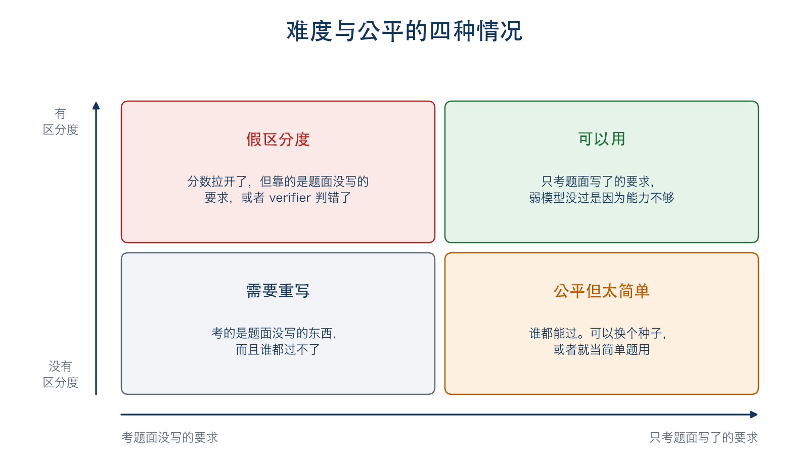
  <p><strong>图 8</strong> 难度与公平的四种情况</p>
</div>

提难度有正当的做法，也有不该用的做法：

| 正当的做法 | 不该用的做法 |
| --- | --- |
| 在已公开的输入范围内，增加边界值和随机用例 | 考题面没写的公式、隐藏数据格式 |
| 检查题面写了、但之前没测的性质 | 检查类名、源码字符串，或者某个模型的习惯写法 |
| 真实的系统上下文，需要跨模块定位问题 | 只是堆更多文件和数据，或者把题面写模糊 |
| 多个来源相互冲突，题面写明谁说了算 | 依赖不可达的工具、随机的网络失败 |
| 全局约束，让贪心解法行不通 | 看着某个模型的代码来针对性出题 |

---

## 第七节：接到评测和训练

任务写好了，就要批量跑起来。这一步有三件事容易出错。

### 不是所有失败都算 Agent 的

沙箱没起来、模型 API 被限流，这些都不是 Agent 的能力问题。把它们记成 0 分，评测和训练都会被污染。

Harbor 用 `reward_valid` 来区分：

<div align="center">
  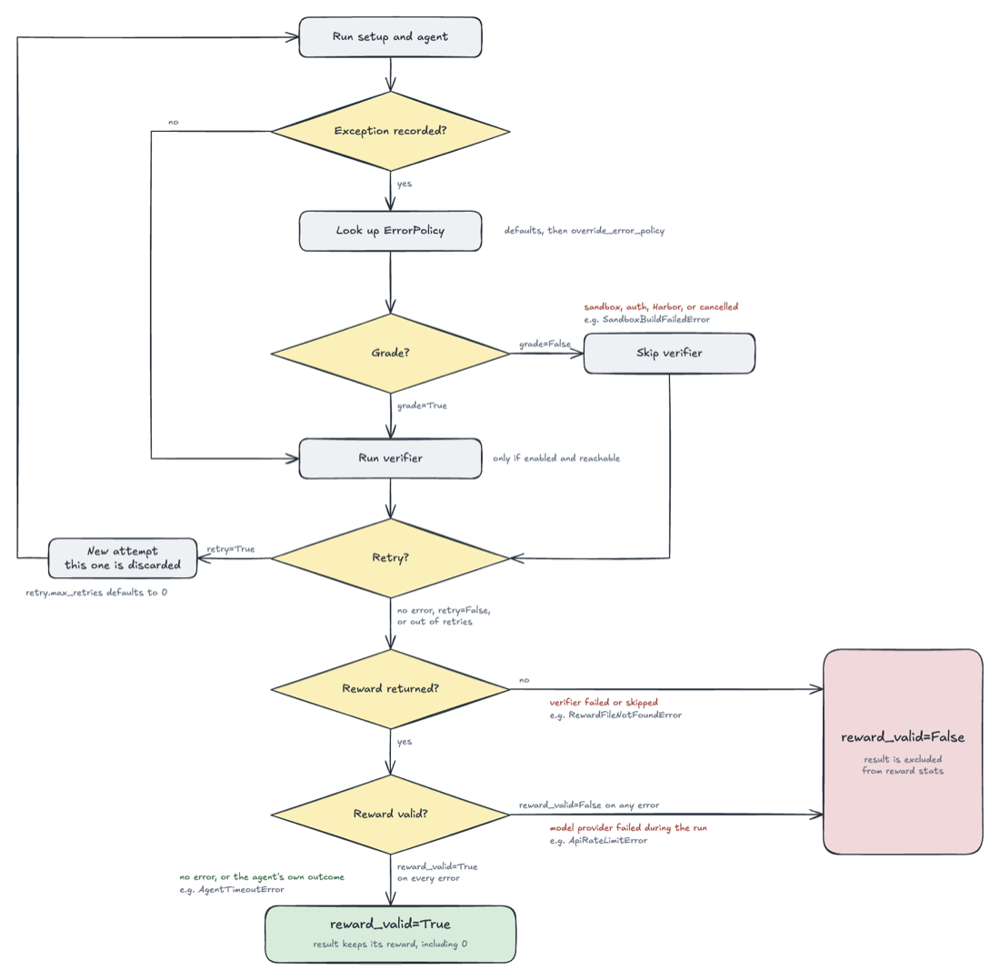
  <p><strong>图 9</strong> Harbor 如何判断 reward 是否有效。图片来源：<a href="https://github.com/harbor-framework/harbor/blob/main/docs-mintlify/jobs/error-classification.mdx">Harbor 文档</a></p>
</div>

| 情况 | 例子 | 是否判分 | reward 是否有效 |
| --- | --- | --- | --- |
| Agent 自己的问题 | 超时、上下文超长 | 判 | 有效，0 分也算数 |
| 环境没起来 | 沙箱构建失败、健康检查失败 | 不判 | 无效 |
| 模型服务出问题 | API 限流、连接中断 | 判 | 无效 |

### 回放还是重跑

环境很多时候需要迭代好几轮，就像第三节的报销任务前后改了四版。每改一次，旧分数还能不能用，要看改的是什么：

<div align="center">
  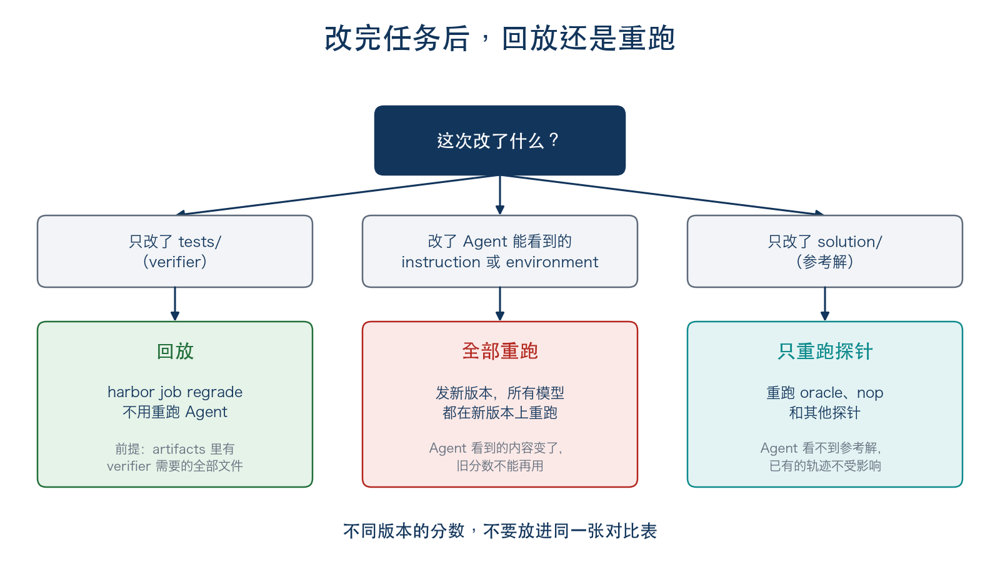
  <p><strong>图 10</strong> 改完任务后，回放还是重跑</p>
</div>

只改 verifier 时可以回放。报销任务从 v2 到 v3 只改了 `tests/`，正好拿来演示。先在 v2 上跑一次改写输入的作弊解法，拿到 1 分；再用 v3 的判分去回放这次运行，Agent 不用重跑：

```bash
cp -R expense-summary/v2 /tmp/v2-cheat
cp probes/shortcut_rewrite_input.sh /tmp/v2-cheat/solution/solve.sh
harbor run -p /tmp/v2-cheat -a oracle -o jobs           # 得 1 分
harbor job regrade jobs/<job目录> -p expense-summary/v3
```

```text
Regrade delta over 1 trial(s): 1 changed (0 up, 1 down), mean reward 1.000 → 0.000
```

回放的前提是 separate verifier 加上 artifacts，verifier 需要的文件当初都得收集下来。报销任务把 `summarize.py` 声明成了 artifact，v3 的判分才能拿到它重新跑。

改了 Agent 能看到的东西，就得让所有模型都在新版本上重跑。只重跑其中一个模型，或者把不同版本的分数放进同一张表里比，都不公平。

### 接到训练框架

环境负责给出 reward，真正的训练交给 RL 框架。以 SkyRL 为例，它的官方文档专门写了 [Harbor 集成](https://github.com/NovaSky-AI/SkyRL/blob/main/docs/content/docs/harbor/index.mdx)：SkyRL 负责生成模型输出，Harbor 负责在沙箱里运行 Agent 并验证结果，得到的 reward 再拿回去更新模型。

<div align="center">
  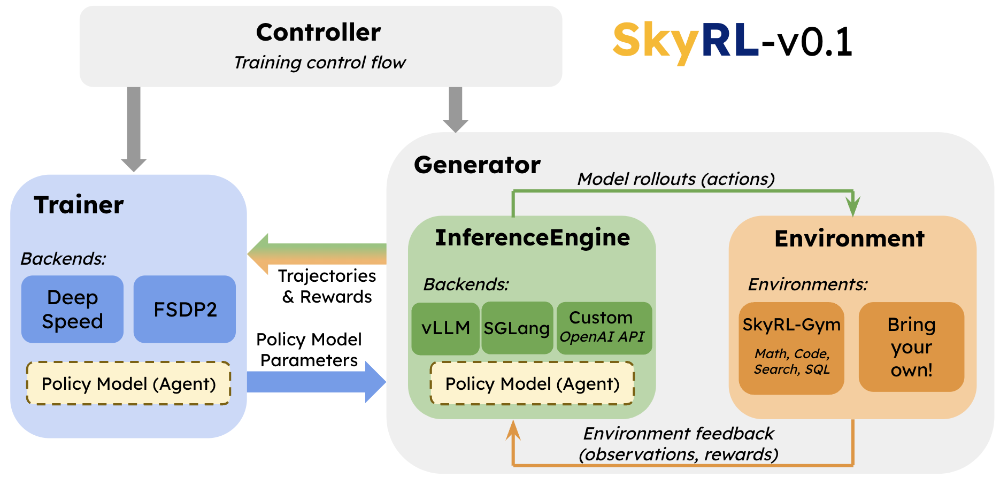
  <p><strong>图 11</strong> 环境在训练系统里的位置：右下角的 Environment 提供观测和奖励。图片来源：<a href="https://github.com/NovaSky-AI/SkyRL">SkyRL 文档</a></p>
</div>

训练本身这里就不展开了，可以接着看[第十一章](../docs/chapter11/第十一章%20Agentic-RL.md)和 [Extra12 旅行助手后训练实战](./Extra12-旅行助手后训练实战.md)。

---

## 参考资料与图片来源

**项目与文档**

- [Harbor](https://github.com/harbor-framework/harbor)，以及 [Harbor Cookbook](https://github.com/harbor-framework/harbor-cookbook)，里面有多容器、多步骤、MCP 工具等更完整的示例
- [Gymnasium](https://github.com/Farama-Foundation/Gymnasium)
- [OpenEnv](https://github.com/openenv/OpenEnv)
- [Prime Intellect verifiers](https://github.com/PrimeIntellect-ai/verifiers)
- [SkyRL](https://github.com/NovaSky-AI/SkyRL)

**论文**

- [Learning to Build the Environment: Self-Evolving Reasoning RL via Verifiable Environment Synthesis](https://arxiv.org/abs/2605.14392)（EvoEnv）
- [Concrete Problems in AI Safety](https://arxiv.org/abs/1606.06565)
- [Monitoring Reasoning Models for Misbehavior and the Risks of Promoting Obfuscation](https://arxiv.org/abs/2503.11926)

**文章**

- [Faulty Reward Functions in the Wild](https://openai.com/index/faulty-reward-functions/)（OpenAI，2016）
- [Reward Hacking in Reinforcement Learning](https://lilianweng.github.io/posts/2024-11-28-reward-hacking/)（Lilian Weng，2024），对 reward hacking 的系统梳理

**图片来源**

图 2、3、4、5、6、8、10 为本文原创，图 7 是本文运行结果在 Harbor 查看页面里的截图。其余图片的来源如下，版权归原作者所有：

| 图 | 来源 | 许可 |
| --- | --- | --- |
| 图 1 | [Gymnasium 文档](https://github.com/Farama-Foundation/Gymnasium) | MIT |
| 图 9 | [Harbor 文档](https://github.com/harbor-framework/harbor/blob/main/docs-mintlify/jobs/error-classification.mdx) | Apache-2.0 |
| 图 11 | [SkyRL 文档](https://github.com/NovaSky-AI/SkyRL) | Apache-2.0 |
