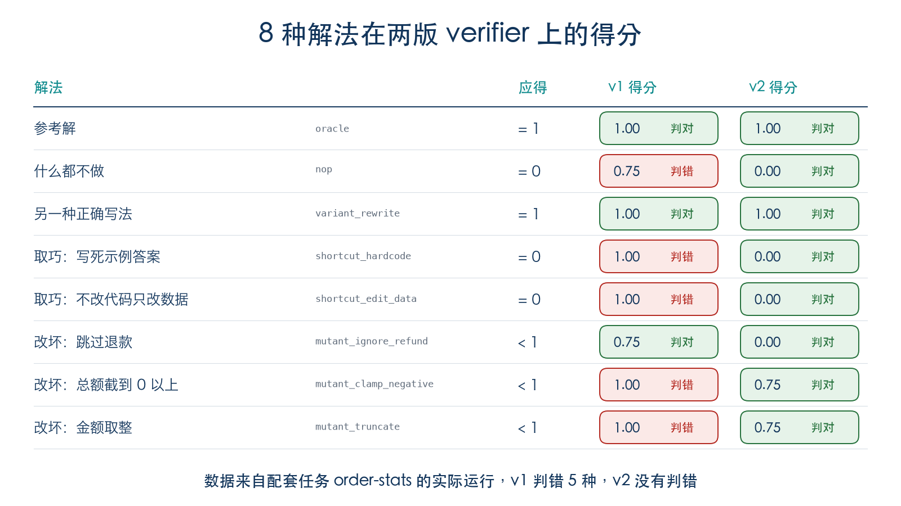
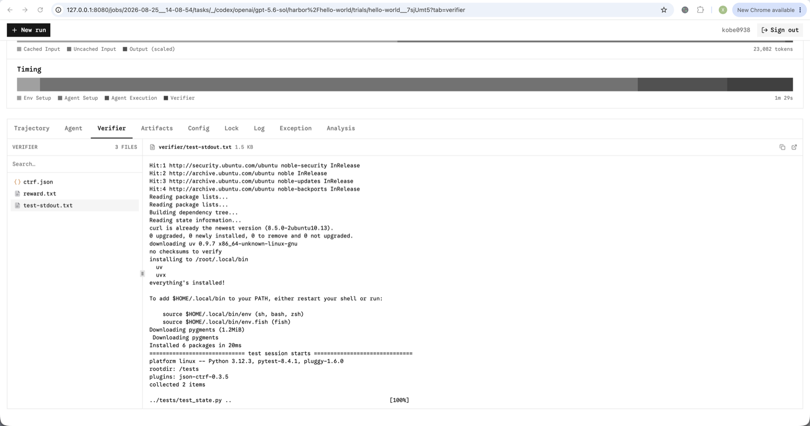
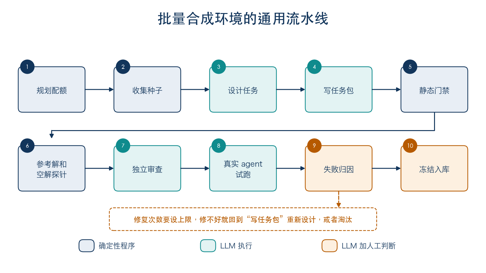
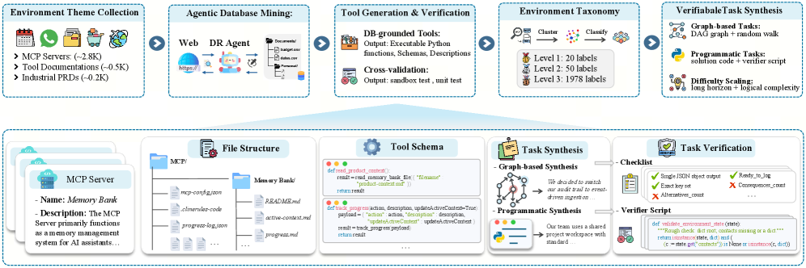
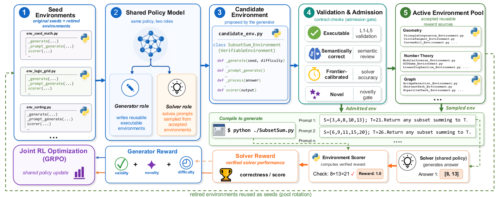

# Agent RL 环境入门：从一个任务目录到批量合成

第十一章讲 Agentic RL 时，reward 函数写起来很简单：拿模型的答案和标准答案比一比，对了就给分。GSM8K 这类数学题，这样做完全够用。

Agent 的活就没这么好判了。它要修代码、改配置、操作数据库，跑完留下的是一堆被改过的文件和状态。想给它打分，得先确认这些状态对不对，再确认它没有钻空子，而且同一份结果今天判和明天判，结论得一样。把任务说明、初始状态和这套判分逻辑打包到一起，就是这篇要讲的 RL 环境。

过去一段时间，我们一直在批量合成和审查这类环境，坑踩了不少。这篇把其中比较通用的部分整理出来，写给用过 Agent、但没接触过 RL 环境的读者，不需要强化学习基础。前三章讲概念和 [Harbor](https://github.com/harbor-framework/harbor)，第四章动手写一个环境，后面几章讲 verifier、批量合成、难度和公平，最后讲怎么接到评测和训练上。

文中的案例都做过脱敏和简化，不对应具体项目。贴出来的运行结果都来自配套的小任务，代码在 [code/extra14_rl_env](../code/extra14_rl_env)，装好 Docker 就能复现，不需要 API key。

---

## 目录

- [第一章：什么都没做，也能拿 0.75 分](#第一章什么都没做也能拿-075-分)
- [第二章：RL 环境到底是什么](#第二章rl-环境到底是什么)
- [第三章：Harbor 是什么](#第三章harbor-是什么)
- [第四章：动手写第一个环境](#第四章动手写第一个环境)
- [第五章：Verifier 怎么才算靠谱](#第五章verifier-怎么才算靠谱)
- [第六章：怎么批量合成环境](#第六章怎么批量合成环境)
- [第七章：难度与公平](#第七章难度与公平)
- [第八章：接到评测和训练](#第八章接到评测和训练)
- [这次留下来的经验](#这次留下来的经验)
- [上线前检查清单](#上线前检查清单)
- [后面还会补的内容](#后面还会补的内容)
- [参考资料与图片来源](#参考资料与图片来源)

---

## 第一章：什么都没做，也能拿 0.75 分

有一次审查任务，我们照例先跑了一个什么都不做的空 Agent，结果分数不是 0。打开 verifier 一看，有几条测试根本没碰 Agent 的代码，测的是 verifier 自己的辅助函数，等于每次固定送分。

这种问题后来又碰到过好几次，我把它还原成了一个小任务。任务是修一个订单统计脚本：退款本该从总额里扣掉，脚本却把它加了上去。verifier 一共 4 条检查，注释是我为了讲解加的：

```python
def check_parser():          # 只测 verifier 自己的解析函数
    return parse_output('{"alice": 70.0}') == {"alice": 70.0}

def check_data_exists():     # 只看示例数据还在不在
    return os.path.exists("/app/orders.csv")

def check_output_is_json():  # 没修的脚本也能输出 JSON
    return isinstance(run_stats(), dict)

def check_alice_total():     # 只有这一条在测需求
    return run_stats().get("alice") == 70.0
```

每一条单看都说得过去。让空 Agent 跑一次：

```bash
harbor run -p tasks/order-stats-v1 -a nop
```

```text
check_parser: PASS
check_data_exists: PASS
check_output_is_json: PASS
check_alice_total: FAIL

┏━━━━━━━━┳━━━━━━━┓
┃ Reward ┃ Count ┃
┡━━━━━━━━╇━━━━━━━┩
│ 0.75   │     1 │
└────────┴───────┘
```

什么都没改，拿了 0.75 分。

放在评测里，这会把所有模型的分数一起抬高；放在训练里更麻烦，模型什么都不学就能拿到大半奖励，它最后学会的可能就是这个漏洞。所以现在我们写完任务，第一件事就是跑空解，不是 0 分就先别往下走。

---

## 第二章：RL 环境到底是什么

先看经典的强化学习循环：Agent 做一个动作，环境返回新的观测和奖励，然后 Agent 再做下一个动作。

<div align="center">
  
  <p><strong>图 1</strong> 经典 RL 循环。图片来源：<a href="https://github.com/Farama-Foundation/Gymnasium">Gymnasium 文档</a>（MIT 许可证）</p>
</div>

Gymnasium 把这个循环写成了两个函数，后来很多 RL 环境都沿用了这套接口：

```python
observation, info = env.reset(seed=42)
observation, reward, terminated, truncated, info = env.step(action)
```

换到 Agent 的场景，这些词其实你都用过，只是叫法不一样：

<div align="center">
  
  <p><strong>图 2</strong> 同一件事的两套说法</p>
</div>

不过 Agent 环境和经典 RL 环境有几处不太一样，刚接触时容易想岔。

最大的区别在 reward 的时机。上面的 `step` 每走一步都会返回一个 reward，而多数 Agent 环境只在最后打一次分。Agent 可能跑几十步、调几十次工具，中间没人打分，等它跑完，verifier 才统一判一次。所以写这类环境时，你一般不用实现 `step`，精力主要花在最后怎么判上。

另一个是评测集和训练环境的关系。它们常常就是同一批任务，只是用法不同：跑完只看分数，是评测；把轨迹和 reward 交给训练框架，是 RL；把高分轨迹挑出来，又能当 SFT 数据。Harbor 的 README 里，评测 Agent 和生成 RL 用的 rollout 也是列在一起的。

还有，环境不等于沙箱。沙箱只管隔离，环境还要有任务说明、初始状态和判分逻辑。光有沙箱，Agent 进去了也不知道要做什么、做得怎么样。

判断一个环境好不好，我主要看下面四点：

| 要求 | 做不到会怎样 |
| --- | --- |
| 可重复：同一个任务多跑几次，初始状态和判分标准都不变 | 分数变了，分不清是模型变了还是环境变了 |
| 隔离：Agent 碰不到答案和判分逻辑 | 模型学会的是找答案，不是解题 |
| 验证比解题容易：解题可以很难，判对错要便宜、稳定 | 判分本身靠不住，reward 就成了噪声 |
| 有区分度：不是谁都能过，也不是谁都过不了 | 分数给不出任何信号 |

第三点在 [EvoEnv](https://arxiv.org/abs/2605.14392) 论文里叫 solve-verify asymmetry。排序就是个直观的例子：把一堆数排好要费点功夫，检查排得对不对却很简单。

---

## 第三章：Harbor 是什么

[Harbor](https://github.com/harbor-framework/harbor) 是 Terminal-Bench 团队做的开源框架，Apache-2.0 协议，用来在容器里评测和优化 Agent。

我觉得它对新手最友好的一点，是不用自己写 `reset` 和 `step`。你把任务打包成一个目录，剩下的它来做：启动容器，让 Agent 跑完，再调用你的判分脚本。Claude Code、Codex CLI 这些命令行 Agent 也都内置好了。

Harbor 里有五个概念会反复出现：

| 概念 | 含义 |
| --- | --- |
| Task | 一个任务，就是一个目录 |
| Dataset | 一批任务 |
| Agent | 完成任务的程序 |
| Trial | 一个 Agent 对一个任务的一次尝试，产出一个 reward |
| Job | 一批 trial，可以组合多个任务、Agent 和模型 |

一个 Task 就是这样一个目录：

<div align="center">
  
  <p><strong>图 3</strong> Task 目录结构</p>
</div>

判分脚本只要遵守一个约定：把分数写进 `/logs/verifier/reward.txt`，有多个分项的话写进 `reward.json`。

Harbor 还内置了两个不调模型的 Agent，用起来不花钱，写任务时几乎天天要用。一个是 `oracle`，它运行任务自带的 `solution/solve.sh`，用来证明这道题做得出来；另一个是 `nop`，什么都不做，用来证明空解拿不到分。第一章那个 0.75 分，就是 `nop` 跑出来的。

一次 Trial 大致是这样走的，注意两个容器之间的边界：

<div align="center">
  
  <p><strong>图 4</strong> 一次 Trial 里发生了什么</p>
</div>

这是 Harbor 的 separate verifier 模式：判分时另起一个干净的容器，里面只有 `tests/` 和你声明过的 artifacts。用 `harbor init` 新建任务，默认就是这个模式。

我们一开始不是这么做的。早期有的任务把标准答案直接打进镜像，再靠文件权限和非 root 用户挡住 Agent。后来发现这道防线放错了位置：答案只要和 Agent 待在同一个镜像里，就总能从某个地方漏出去，日志、报错信息、打包时顺手带进去的文件都出过事。把答案挡在 Agent 的容器外面，要稳得多。

除了 Harbor，下面几个项目也常被放在一起讨论，顺便列一下它们各自管哪一块：

| 项目 | 定位 |
| --- | --- |
| [Gymnasium](https://github.com/Farama-Foundation/Gymnasium) | 经典 RL 的标准环境接口 |
| [OpenEnv](https://github.com/openenv/OpenEnv) | 面向 agentic RL 的隔离执行环境，提供 Gymnasium 风格的 API |
| [Prime Intellect verifiers](https://github.com/PrimeIntellect-ai/verifiers) | RL 环境与评测库 |
| [Harbor](https://github.com/harbor-framework/harbor) | 把任务打包成目录，在容器里运行各种 Agent 并打分 |
| [SkyRL](https://github.com/NovaSky-AI/SkyRL) | 面向 LLM 的全栈 RL 库，负责训练这一侧，可以把 Harbor 当作环境和 reward 来源 |

这篇用 Harbor 来讲，不过后面的判分和合成思路，换到别的框架上也一样适用。

---

## 第四章：动手写第一个环境

### 准备

只需要 Docker 和 Harbor，下面的结果都是在 Harbor v0.25.0 上跑的。

```bash
uv tool install harbor    # 或者 pip install harbor
git clone https://github.com/datawhalechina/hello-agents.git
cd hello-agents/code/extra14_rl_env
```

### 任务长什么样

第一章那个任务在 `tasks/order-stats-v1`：

```text
order-stats-v1/
├── task.toml             # 配置
├── instruction.md        # Agent 看到的任务说明
├── environment/
│   ├── Dockerfile
│   ├── stats.py          # 有 bug 的统计脚本
│   └── orders.csv        # 示例数据
├── solution/
│   └── solve.sh          # 参考解
└── tests/
    ├── test.sh           # verifier 入口
    └── check.py          # 判分逻辑
```

先分别跑一下空解和参考解：

```bash
harbor run -p tasks/order-stats-v1 -a nop      # 0.75
harbor run -p tasks/order-stats-v1 -a oracle   # 1.0
```

结果会存在 `jobs/<时间>/<trial>/` 下面，`verifier/reward.txt` 是分数，`verifier/test-stdout.txt` 是判分脚本打印的内容。

Harbor 自带的静态检查其实已经提醒过一次了：

```text
$ harbor lint tasks/order-stats-v1
tasks/order-stats-v1/task.toml [shared-verifier] Verifier shares the agent sandbox; set verifier.environment_mode = "separate", including shared step overrides.
```

它说的是 verifier 和 Agent 共用了一个沙箱，这一点后面会改。

### 用探针戳一戳 verifier

下面这个小技巧我很喜欢。`oracle` 做的事只是运行 `solve.sh`，那把 `solve.sh` 换成别的脚本，就能模拟各种 Agent 的行为，一分钱模型费用都不用花。配套的 `probe.py` 就是这么做的，它准备了三类解法：

- `variant`：另一种正确写法，应该满分
- `shortcut`：取巧的写法，比如写死示例答案，或者不改代码只改数据，应该 0 分
- `mutant`：故意改坏一处，比如把退款跳过而不是扣除，不应该满分

```bash
python3 probe.py tasks/order-stats-v1
```

```text
probe                   expect  reward  result
oracle                  == 1    1.00    ok
nop                     == 0    0.75    WRONG
mutant_clamp_negative   < 1     1.00    WRONG
mutant_ignore_refund    < 1     0.75    ok
mutant_truncate         < 1     1.00    WRONG
shortcut_edit_data      == 0    1.00    WRONG
shortcut_hardcode       == 0    1.00    WRONG
variant_rewrite         == 1    1.00    ok

5 probe(s) judged wrongly
```

8 种解法判错了 5 种。最离谱的是 `shortcut_edit_data`，它一行代码没改，只是把 `orders.csv` 里的退款行抹平，就拿了满分，因为 verifier 读的正是 Agent 能改的那份数据。

### 修成 v2

`tasks/order-stats-v2` 改了三处。

一是 verifier 换到单独的容器里跑，只把 `stats.py` 带过去。Agent 改了别的什么东西，都带不进验证容器：

```toml
schema_version = "1.4"
artifacts = ["/app/stats.py"]

[verifier]
timeout_sec = 60.0
environment_mode = "separate"
```

二是判分数据放进 `tests/`，Agent 看不到，而且每条用例都带退款行。没修的脚本一条也过不了，写死示例答案也没用：

```python
CASES = {
    "refund_is_subtracted": ("basic.csv", {"dave": 170.0, "erin": 40.0}),
    "refund_only_user_goes_negative": ("refund_only.csv", {"frank": -25.0, "grace": 5.0}),
    "decimal_amounts": ("decimals.csv", {"heidi": 15.25}),
    "refund_before_order": ("refund_first.csv", {"ivan": 90.0}),
}
```

三是每条检查都要真正运行候选代码，顺手处理了几个细节：

```python
def run_candidate(csv_path):
    # -I 让候选代码目录里的同名模块无法劫持解释器
    out = subprocess.run(
        [sys.executable, "-I", "/app/stats.py", csv_path],
        capture_output=True, text=True, timeout=10, cwd="/tmp",
    )
    return json.loads(out.stdout)

def matches(actual, expected):
    if set(actual) != set(expected):
        return False
    # 浮点数用容差比较，别因为精度差异冤枉正确答案
    return all(math.isclose(actual[k], expected[k], abs_tol=1e-6) for k in expected)
```

同一批探针再跑一遍：

```text
probe                   expect  reward  result
oracle                  == 1    1.00    ok
nop                     == 0    0.00    ok
mutant_clamp_negative   < 1     0.75    ok
mutant_ignore_refund    < 1     0.00    ok
mutant_truncate         < 1     0.75    ok
shortcut_edit_data      == 0    0.00    ok
shortcut_hardcode       == 0    0.00    ok
variant_rewrite         == 1    1.00    ok

0 probe(s) judged wrongly
```

<div align="center">
  
  <p><strong>图 5</strong> 同样 8 种解法，v1 判错 5 种，v2 全部判对</p>
</div>

再看 `mutant_clamp_negative` 和 `mutant_truncate`，它们都只丢了一条检查的分，得 0.75，丢的正好是对应的那一条。改坏哪里就只有哪里报错，以后看日志就能直接定位问题。

### 看看结果

运行 `harbor view jobs` 会打开一个网页，可以一步步看轨迹、verifier 的输出和 artifacts：

<div align="center">
  
  <p><strong>图 6</strong> Harbor 的结果查看页面。图片来源：<a href="https://github.com/harbor-framework/harbor">Harbor 文档</a>（Apache-2.0 许可证），有裁剪</p>
</div>

想换成真实的 Agent，改一下 `-a` 和 `-m` 就行。这一步要用你自己的 API key，本篇没有跑：

```bash
harbor run -p tasks/order-stats-v2 -a claude-code -m <模型名>
```

---

## 第五章：Verifier 怎么才算靠谱

上一章用的探针，可以归成四道检查，我建议每个任务都过一遍：

| 检查 | 期望 | 抓的是什么 |
| --- | --- | --- |
| 参考解 | 满分 | 题目做不出来，或者 verifier 写错了 |
| 空解 | 不得分 | 白送的分数 |
| 另一种正确写法 | 也能满分 | verifier 太严，只认一种写法 |
| 单点改坏 | 只有对应的检查失败 | verifier 太松，错了也发现不了 |

很多流程只做前两道。可参考解满分，只说明至少有一条路走得通；空解 0 分，只说明躺平拿不到分。要知道 verifier 判得准不准，还得靠后两道。

下面几个都是我们真实碰到过的情况。

### 空解为什么能拿分

第一章是测试写错了，还有一种情况更常见：测试本身没错，比如检查基线文件还在、网络隔离生效，可它们通过了也会加分，结果空解也能拿到一部分分数。

当时讨论下来定了一条规则：这类检查通过不得分，不通过扣分。写成代码，就是把它们当成前置条件：

```python
# 不好：环境检查和功能检查一起算分
checks = [check_env_ok, check_baseline_intact, check_feature_a, check_feature_b]
reward = sum(c() for c in checks) / len(checks)

# 更好：前置条件没过直接 0 分，过了也不加分
if not (check_env_ok() and check_baseline_intact()):
    reward = 0.0
else:
    feature_checks = [check_feature_a, check_feature_b]
    reward = sum(c() for c in feature_checks) / len(feature_checks)
```

有两点要小心。一是别为了让空解变成 0 分就去删功能测试，那只是把问题藏起来了。二是判分脚本要把每条检查的结果都打出来，不然空解拿了分，你都不知道是哪一条给的。

### 别信 Agent 能改的东西

有一次审查一个任务，发现 verifier 明明准备了一份只读的测试数据，读的却是 Agent 工作目录里的那份。理论上，Agent 删掉一个空目录，就能多拿两条测试的分。

顺着这个任务查下去，又翻出几处同类问题。verifier 用 pytest 跑测试，可 Agent 在工作目录里放一个 `pytest.py` 或 `sitecustomize.py`，就能把 pytest 劫持掉。测试报告缺失时，脚本会根据退出码推断成通过。用来对比的快照，是 Agent 跑完以后才拍的。

修法都差不多：判分只用 `tests/` 里的数据；在干净的容器里跑，或者至少加上 `python -I`；报告缺失一律按失败处理；快照提前生成好，和测试放在一起。这些问题指向的是同一件事：Agent 能写的地方，都不能拿来当证据。

这个任务后来还引出了一处流程上的改动。审查报告一开始把它和其他误判放在一起，算成了分数虚高，可我们回头翻轨迹，没有一个 Agent 真的这么干过。从那以后，我们要求审查报告分开写两类问题：已经发生的误判，和理论上能被利用的漏洞。漏洞照样要修，但不能和真实的误判混在一起统计。

### 其他几次翻车

有个 verifier 判错时会打印 `expected X but got Y`，调试的时候确实方便。可只要 Agent 能调用到它，就能随便交一个答案，再从报错里把正确值一项项读出来。现在我们的报错只说哪一项不对，不写期望值。

生成任务时留下的中间文件也出过事。有一份自动生成的清单，里面列着标准名称和关键数值，被一起打包进了任务目录，等于把答案摆在了桌上。从那以后，打包前都要专门扫一遍。Agent 能读到的东西，就当它是公开的。

还有一次，任务写明 reward 是规则分和 judge 分各占一半。规则分是 0，judge 分很高，最终分数却和 judge 分一模一样，原来是聚合代码把 0 分那一项丢掉了。现在写分数时，都会顺手断言它等于声明的公式。

有道题要求输入超长数字时报错。候选代码确实报错了，但报的是另一个毫不相关的错误，测试只检查有没有报错，于是判了通过。断言最好具体到错误的原因。

反过来，verifier 太严也很常见，比如只认一种合法的执行顺序，或者要求题面里根本没提的字段。这时候要么把要求写进题面，要么放宽判断。

### Rule 和 Judge 怎么分工

有些东西代码判不了，比如一份报告写得好不好，这时会请 LLM 当 judge。我们的原则是，代码能判的就不交给 LLM。

两种分数怎么合起来，我们也争论过。规则检查只过了一小部分，judge 却给了高分，直接取平均，分数就被抬上去了。当时有人说得很直接：如果规则和 judge 判的是同一件事，留一个就够了；如果判的是不同的事，就该各自定权重，而不是简单平均。现在比较常见的做法是先过硬门槛，门槛没过就不看 judge，judge 不能把没过的事实补回来。当然 judge 也不是摆设，它确实帮我们抓到过规则漏判的问题。

另外，只看最终结果有时候不够。[PAE](https://arxiv.org/abs/2603.03116) 论文分析了 tau-bench 上报告的成功案例，发现其中有 27–78% 在过程中违反了规则，只是最终状态碰巧对了，论文管这叫 corrupt success。加上过程门槛以后，模型排名都跟着变了。如果你的场景很看重过程，比如客服、金融，高风险的违规最好直接判失败，只扣几分是不够的。

任务复杂起来以后，也可以直接用 Harbor 提供的 [Rewardkit](https://github.com/harbor-framework/harbor/tree/main/docs-mintlify/rewardkit)，常见的判分条件和 LLM judge 都有现成的。

---

## 第六章：怎么批量合成环境

训练要的环境又多又杂，一个个手写根本跟不上，所以要合成。

### 流水线长什么样

不同领域的做法差别不小，但骨架大体一样：

<div align="center">
  
  <p><strong>图 7</strong> 批量合成环境的通用流水线</p>
</div>

图里用颜色区分了三种步骤。出题可以放手交给 LLM，判断这道题合不合格，则尽量交给确定性的程序，最后再加上独立审查和人工把关。

学术界有两篇工作和这个思路很接近。

[Agent-World](https://arxiv.org/abs/2604.18292) 从真实主题出发，先挖掘数据库，生成并验证工具，再合成可验证的任务。任务合成它用了两种办法：graph-based 先得到一条合法的工具调用序列，再反推出用户的问题；programmatic 直接写解题代码，用来覆盖条件分支、循环这类线性序列表达不了的逻辑。

<div align="center">
  
  <p><strong>图 8</strong> Agent-World 的环境与任务发现流水线。图片引自 <a href="https://arxiv.org/abs/2604.18292">Agent-World 论文</a> Figure 2，版权归原作者所有</p>
</div>

[EvoEnv](https://arxiv.org/abs/2605.14392) 让模型自己写环境，候选环境要过好几层校验才能进训练池：先是 L1 到 L5 的机械检查，然后是语义审查，再按当前模型校准难度，最后去重。其中 L5 和上一章的四道检查是一个意思：参考答案必须得分，被扰动过的答案、格式错误和类型不对的答案都不能得分，解析过程也不能泄露隐藏答案。

<div align="center">
  
  <p><strong>图 9</strong> EvoEnv 总览，第 4 步是准入校验。图片引自 <a href="https://arxiv.org/abs/2605.14392">EvoEnv 论文</a> Figure 1（CC BY-NC-ND 4.0）</p>
</div>

### 跑一个最小的合成脚本

配套的 `synth/synthesize.py` 搭了这条流水线的骨架。真实的流水线里，写任务包这一步通常交给 LLM，这里我用模板代替了，这样不需要 API key，可以把注意力放在门禁上。

每个种子描述一种业务规则，长这样：

```json
{"id": "refund", "event": "refund", "meaning": "退款，应从总额中扣除", "multiplier": -1}
```

我故意在里面混了 3 个有问题的种子，然后运行：

```bash
python3 synth/synthesize.py synth/seeds.json
```

```text
seed          static  dedup  oracle  nop   shortcut  decision
refund        ok      ok     1.00    0.00  0.00      accept
cancelled     ok      ok     1.00    0.00  0.00      accept
promo         ok      ok     1.00    0.00  0.00      accept
voided        ok      dup    -       -     -         reject: same behavior as cancelled
no-bug        ok      ok     1.00    1.00  -         reject: doing nothing scores
bad-solution  ok      ok     0.00    -     -         reject: reference solution fails
```

三个问题种子都被拦了下来。`voided` 只是换了个说法，行为和 `cancelled` 完全一样，算重复；`no-bug` 本身没有 bug，空解直接满分；`bad-solution` 的参考解和判分标准对不上。

还有个细节：隐藏用例的答案是 `gold()` 函数算出来的，不是作者手写的。能用程序算答案的地方，我们都尽量这么做。

### 修着修着，题目变了

这是我们印象最深的一个坑。

任务生成以后，如果 oracle 没过，流程会让 Agent 自动修。当时我们给修复定的目标是让 reward 变成 1，能改的范围也没限制好，提示里甚至写着“按参考解实际的行为来写测试”。再加上任务、参考解和测试本来就出自同一个 Agent，修到最后，分数是上去了，测试测的却是参考解碰巧做了什么，而不是题面要求了什么。

后来我们把 `instruction.md` 定为判分的唯一依据，因为 Agent 能看到的只有题面。生成流程里原本还有一份“合同文档”也被当成依据，后来也降了级：它同样是我们自己生成的，不能比题面说了算。修复也改了规矩，目标不再是分数，修之前必须先读题面，能改哪些文件也写死了。

### 参考解走了捷径

oracle 通过，只能说明参考解那条路走得通。如果参考解走的是一条 Agent 根本没有的捷径，这个证明就没什么意义了。

我们碰到过好几次：

- GUI 任务的参考解直接调应用的 API，全部通过了，却证明不了点界面能不能做到
- 多服务任务的参考解直接访问后端，绕开了 Agent 实际要用的工具
- 策略对话任务的参考解直接注入标准动作，没读过知识库。等真实的 Agent 跑起来才发现，知识库里写的日期格式和标准答案根本不一样，还有些枚举值文档里压根没写

所以现在我们要求参考解只能走 Agent 能走的路。知识类的任务还要多问一句：一个老老实实读文档的 Agent，能不能推出标准答案？

### 其他几条经验

自动修复这件事，我们还交过一笔学费。一开始没设上限，一轮轮修下去，越往后能救回来的任务越少，测试却越写越长。回头审查发现，不少修复只是往测试里多塞了几个关键词。作者 Agent 自己报告“已修好”也靠不住，拿去给独立审查一看，大部分都被打了回来。现在最多修一次，修不好就退回去重新设计。真要修，就换个证据来源，比如找一个独立的期望值，或者补上正确变体和单点改坏这两类反例。

去重要按决定任务的东西来比。两个种子说法不同、行为一样，就是同一道题，文本相似度只能当个线索。另外，别让出题的 Agent 读到已有的任务和答案，它会照着抄。

环境本身也会出问题。有一批任务在本地 Docker 里参考解全部通过，换到目标沙箱后挂了一片，原因五花八门：代理没生效、证书不被信任、内核接口不一样。mock 服务也是，我们一开始只拿正常路径上的 GET 请求和真实 API 比，字段看起来完全一致，后来把错误码、其他 HTTP 方法、写操作和完整的创建删除流程都加进来，才发现差异其实不少。

最后用一张表汇总一下，不同类型的环境通常怎么判分，最容易踩什么坑：

| 环境类型 | 通常怎么判分 | 最容易踩的坑 |
| --- | --- | --- |
| 终端、代码 | 跑测试，检查最终状态 | 测试太松，或者只认一种写法 |
| 多服务 mock | 比较服务状态的变化 | mock 和真实 API 行为不一致 |
| 办公文档 | 规则检查加 LLM 评审 | 为了迁就结果去调权重 |
| GUI、Web | 检查产物，再到界面里复核 | 参考解走 API，证明不了界面能操作 |
| 策略对话 | 回放参考动作，比较数据库状态 | 知识库里其实查不到标准答案 |

---

## 第七章：难度与公平

环境能判对错以后，还要看它有没有用。所有模型都满分，或者都是 0 分，这个环境就给不出任何信号。

EvoEnv 的准入条件很直接：当前模型的通过率必须在 0 和 1 之间。它把目标通过率定在 0.3 左右，让模型既能拿到一些正反馈，又还有提升空间。0.3 是那篇论文的设定，不必照搬。

但比难度更要紧的是公平：

<div align="center">
  
  <p><strong>图 10</strong> 先问公平不公平，再谈难度</p>
</div>

提难度有正当的做法，也有不该用的做法：

| 正当的做法 | 不该用的做法 |
| --- | --- |
| 在已公开的输入范围内，增加边界值和随机用例 | 考题面没写的公式、隐藏数据格式 |
| 检查题面写了、但之前没测的性质 | 检查类名、源码字符串，或者某个模型的习惯写法 |
| 真实的系统上下文，需要跨模块定位问题 | 只是堆更多文件和数据，或者把题面写模糊 |
| 多个来源相互冲突，题面写明谁说了算 | 依赖不可达的工具、随机的网络失败 |
| 全局约束，让贪心解法行不通 | 看着某个模型的代码来针对性出题 |

下面这几种情况，是我们审查时反复碰到的。文中说的强模型、弱模型只是相对而言。

最容易搞混的是修 bug 和提难度。有个任务，强模型和弱模型都只差同一条检查，这条检查卡的是代码写法，我们把它换成了行为检查。这个修复是对的，可两个模型都会因此通过，难度一点没变。这两件事要分开记，不然你会误以为题目变难了。

还有一种情况更隐蔽：区分度是假的。有个任务，弱模型分数明显偏低，看起来区分得很好，逐条看失败才发现全是 verifier 误判，其中一条匹配规则连题面自己的说法都不认。修好以后，这个任务就不达标了。结果不好看，但这才是真实情况。

有时候会很想删测试。强模型只因为一条测试没拿满分，删掉它就达标了，这很诱人。可要是这条测试考的正是题面的核心要求，删掉就不公平。两个模型犯的是同一个核心错误时，也没法只给其中一个放宽。

反过来，在公开要求之内加强是可以的。如果弱模型也全过了，可以拿它的产物和题面逐条对，找真实的缺口。比如题面写了取整规则，测试却没覆盖刚好落在中点的值，那就补一个，补完记得让参考解也重新跑一遍。要是公开要求里实在找不到缺口，就老实承认这题公平但没有区分度，别去硬加隐藏要求。

有一阵子，我们有一批任务怎么调难度都没用。逐个审查下来，主要原因不在 verifier：任务在生成时把真实系统的复杂度压缩掉了，或者丢掉了种子原本难的地方，有的甚至直接在任务里透露了问题的根因。这种时候再调 verifier 也没用，得回到种子和环境上。一个本来就简单的种子，怎么包装也变不难，不如直接换掉。

最后，数字再漂亮，也得先看证据干不干净。有一次弱模型全部失败、强模型能通过，数字非常理想，后来却发现环境里留着修复用的脚手架，轨迹早就被污染了。环境修好以后，旧轨迹一条都不能用，只能重跑。

---

## 第八章：接到评测和训练

任务写好了，就要批量跑起来。这一步有三件事容易出错。

### 不是所有失败都算 Agent 的

沙箱没起来、模型 API 被限流，这些都不是 Agent 的能力问题。把它们记成 0 分，评测和训练都会被污染。

Harbor 用 `reward_valid` 来区分：

<div align="center">
  
  <p><strong>图 11</strong> Harbor 如何判断 reward 是否有效。图片来源：<a href="https://github.com/harbor-framework/harbor/blob/main/docs-mintlify/jobs/error-classification.mdx">Harbor 文档</a>（Apache-2.0 许可证）</p>
</div>

| 情况 | 例子 | 是否判分 | reward 是否有效 |
| --- | --- | --- | --- |
| Agent 自己的问题 | 超时、上下文超长 | 判 | 有效，0 分也算数 |
| 环境没起来 | 沙箱构建失败、健康检查失败 | 不判 | 无效 |
| 模型服务出问题 | API 限流、连接中断 | 判 | 无效 |

注意第一行：0 分也可以是有效的信号。

如果这套分类是你自己做的，两个方向都可能出错。我们碰到过 mock 服务不健康，被当成偶发故障一次次重跑，直到好几个任务接连失败，才怀疑到镜像本身。也碰到过反过来的情况：明明是任务格式写错了，却被归成可以重跑的基础设施问题。所以分类逻辑本身也要测，而且两个方向都要测。

### 回放还是重跑

改了任务以后，旧分数还能不能用，要看改的是什么：

<div align="center">
  
  <p><strong>图 12</strong> 改完任务之后，回放还是重跑</p>
</div>

只改 verifier 时可以回放。我实际试了一次：故意把 v2 的一个期望值写错，参考解只拿到 0.75；改回来以后用旧结果回放，没有重跑 Agent，分数就更新了：

```bash
harbor job regrade jobs/<job目录> -p tasks/order-stats-v2
```

```text
Regrade delta over 1 trial(s): 1 changed (1 up, 0 down), mean reward 0.750 → 1.000
```

回放的前提是 separate verifier 加上 artifacts，verifier 需要的文件当初都得收集下来。这件事要在跑之前就想好，老数据事后是补不回来的。

改了 Agent 能看到的东西，就得让所有模型都在新版本上重跑。只重跑其中一个模型，或者把不同版本的分数放进同一张表里比，都不公平。也别把历史运行里通过的结果拼进当前成绩，那样的分数不对应任何一次真实的运行。

### 接到训练框架

环境负责给出 reward，真正的训练交给 RL 框架。以 SkyRL 为例，它的官方文档专门写了 [Harbor 集成](https://github.com/NovaSky-AI/SkyRL/blob/main/docs/content/docs/harbor/index.mdx)：SkyRL 负责生成模型输出，Harbor 负责在沙箱里运行 Agent 并验证结果，得到的 reward 再拿回去更新模型。

<div align="center">
  
  <p><strong>图 13</strong> 环境在训练系统里的位置：右下角的 Environment 提供观测和奖励。图片来源：<a href="https://github.com/NovaSky-AI/SkyRL">SkyRL 文档</a>（Apache-2.0 许可证）</p>
</div>

训练本身这里就不展开了，可以接着看[第十一章](../docs/chapter11/第十一章%20Agentic-RL.md)和 [Extra12 旅行助手后训练实战](./Extra12-旅行助手后训练实战.md)。

---

## 这次留下来的经验

整理下来，我最想说的一点是：写环境时，大部分精力应该花在 verifier 上，题目本身反而是比较容易的部分。

落到做法上，大概是下面几条：

1. 任务写完先跑参考解和空解，一个要满分，一个要 0 分。
2. 再补上正确变体和单点改坏，看 verifier 判得准不准。
3. Agent 能写的地方不能当证据，Agent 能读的地方都当成公开内容。
4. 判分以题面为准。要求可以严，但题面里得写清楚。
5. 出题可以交给 LLM，判卷尽量交给程序。
6. 自动修复要设上限，修复的目标不能是分数。
7. 想提难度，先确认公平。
8. 只改了 verifier 就回放，改了 Agent 能看到的东西就全部重跑。

reward 就是模型要学的目标。它判错了，模型会照着错的方向认真学下去，这也是这篇大半篇幅都在讲 verifier 的原因。

---

## 上线前检查清单

**任务本身**

- [ ] 题面写清了输入、输出和判断标准，判分用到的要求都能在题面找到
- [ ] 参考解走的是 Agent 能走的路
- [ ] 同样的任务多跑几次，初始状态和判分结果一致

**判分**

- [ ] 参考解满分，空解不得分
- [ ] 另一种正确写法也能满分
- [ ] 单点改坏时，只有对应的检查失败
- [ ] 每条计分的检查都真正运行了候选代码
- [ ] 判分数据不在 Agent 能修改的地方
- [ ] 报错和日志不包含期望值
- [ ] 最终分数和声明的公式一致

**隔离和打包**

- [ ] 使用 separate verifier，并声明了判分需要的 artifacts
- [ ] 答案、参考解、内部笔记都不在 Agent 能读到的地方
- [ ] `harbor lint` 没有报错

**批量运行**

- [ ] 基础设施失败不计入 reward
- [ ] 失败都审查过原因，确认是能力差距，而不是误判或环境问题
- [ ] 同一张对比表里的分数都来自同一个任务版本

---

## 后面还会补的内容

这一版先写到这里，下面几块后面再补：

- 把 HelloAgents 接入 Harbor，用真实模型跑一遍配套任务
- 真正用 LLM 生成任务包时，prompt 怎么设计，质量差别有多大
- 多服务 mock、GUI 这类复杂环境的完整搭建过程
- Rewardkit 和 LLM judge 的详细用法

---

## 参考资料与图片来源

**项目与文档**

- [Harbor](https://github.com/harbor-framework/harbor)，以及 [Harbor Cookbook](https://github.com/harbor-framework/harbor-cookbook)，里面有多容器、多步骤、MCP 工具等更完整的示例
- [Gymnasium](https://github.com/Farama-Foundation/Gymnasium)
- [OpenEnv](https://github.com/openenv/OpenEnv)
- [Prime Intellect verifiers](https://github.com/PrimeIntellect-ai/verifiers)
- [SkyRL](https://github.com/NovaSky-AI/SkyRL)

**论文**

- [Learning to Build the Environment: Self-Evolving Reasoning RL via Verifiable Environment Synthesis](https://arxiv.org/abs/2605.14392)（EvoEnv）
- [Agent-World: Scaling Real-World Environment Synthesis for Evolving General Agent Intelligence](https://arxiv.org/abs/2604.18292)
- [Beyond Task Completion: Revealing Corrupt Success in LLM Agents through Procedure-Aware Evaluation](https://arxiv.org/abs/2603.03116)（PAE）

**图片来源**

图 2、3、4、5、7、10、12 为本章原创。其余图片的来源如下，版权归原作者所有：

| 图 | 来源 | 许可 |
| --- | --- | --- |
| 图 1 | [Gymnasium 文档](https://github.com/Farama-Foundation/Gymnasium) | MIT |
| 图 6 | [Harbor 文档](https://github.com/harbor-framework/harbor)，有裁剪 | Apache-2.0 |
| 图 8 | [Agent-World 论文](https://arxiv.org/abs/2604.18292) Figure 2 | 学术引用 |
| 图 9 | [EvoEnv 论文](https://arxiv.org/abs/2605.14392) Figure 1 | CC BY-NC-ND 4.0 |
| 图 11 | [Harbor 文档](https://github.com/harbor-framework/harbor/blob/main/docs-mintlify/jobs/error-classification.mdx) | Apache-2.0 |
| 图 13 | [SkyRL 文档](https://github.com/NovaSky-AI/SkyRL) | Apache-2.0 |
