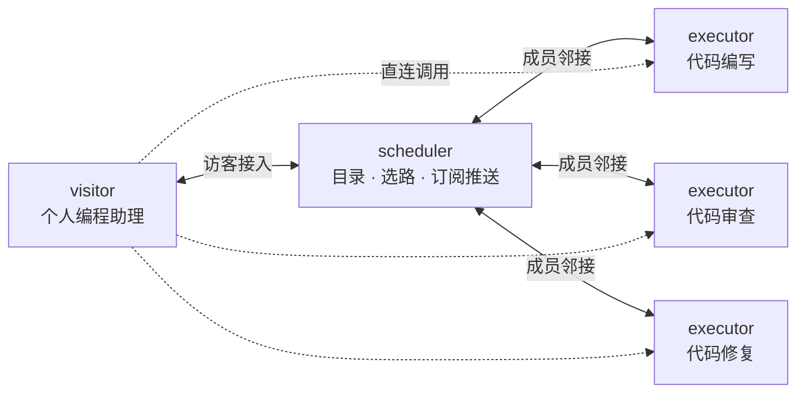

# 多 Agent 组网探索——ARPTool 的设计、使用与动态 Agent 实战

## 一、前言

**ARPTool（Agent Route Protocol Tool）**是我个人维护项目，主要解决两个问题：如何将 Agent 接入服务网络，以及如何在运行时动态发现和调用网络中的服务。

目前，应用调用其他 Agent 时，通常需要预先配置服务名称、地址和能力说明。服务上线、下线或发生变化后，调用方也要同步修改配置。随着 Agent 数量和变化频率增加，这种静态名单会越来越难维护。

ARPTool 借鉴计算机网络协议的设计思想，把每个 Agent 视为一个节点：节点入网后通告自身能力，网络持续维护成员和能力视图，调用方根据实时目录选择服务。这样，新能力上线后可以直接被发现，调用方不必反复修改配置。

本文介绍 ARPTool 的主要设计，并通过代码演示建网、服务发现、远程调用，以及宿主 LLM 如何在工具调用循环中使用这些能力。项目当前面向团队内部等**可信环境**，不解决开放互联网中的身份认证与跨组织互信问题。

项目仓库：[https://github.com/Sun975/arptool](https://github.com/Sun975/arptool)

## 二、设计理念

ARPTool 的核心思路是：让 Agent 相互连接，组成一张能够维护成员与能力信息的服务网络。ARP 按职责划分三种节点角色，当前采用调度者骨干与执行者叶子组成的星型组网。

### 2.1 ARP 角色与协议流程

第一类是**调度者。**这类节点不直接解决问题，而是作为一个调度管理节点，将需求规划、拆分并选择适合的其他agent处理。因为需要选择其他agent节点，所以调度者需要动态掌握全网视图，即当前网络有哪些节点可以提供哪些服务。调度者组成了agent网络的主干。如果两两连接，存在链接开销、泛洪等问题，所以设计以一个DIS（中间通告系统）。优选一个调度者作为DIS，所有其他调度者都和DIS建立链接，所有网络中的agent更新信息先发给DIS，然后DIS发给其他调度者。

第二类是**执行者（executor）。** 部分节点直接提供某些服务，例如编写代码、审查代码或执行测试。因为只提供服务，所以在网络里的功能只需要通知别人自己的存活状态和能力就可以，不需要感知其他agent节点，不需要维护全网视图。所以设计作为一个供给侧，保持简单，作为agent网络的叶子节点，和网络中的一个调度者建立链接，然后把能力通告给调度者，调度者再通过DIS机制，通告全网洽其他调度者。

第三类是**访客（visitor）。** 作为一个agent网络服务的请求方，它不向外提供服务，也不参与能力泛洪，只使用网络中的服务，一般是直接面向用户应用。因为需要查询全网视图，所以和调度者建立链接。接入调度者后，订阅对应agent，获取实时能力变化，可以向调度者下发需求，调度者规划解决。也可以获取agent的能力后，直接调用执行者的服务。所以调度者也承担了为访客提供服务发现的职责。

| 角色 | 主要职责 | 是否维护全网视图 | 是否可被调用 | 是否可发起调用 |
| --- | --- | --- | --- | --- |
| 调度者 | 维护目录、收敛能力信息、提供候选与选路 | 是 | 是 | 是 |
| 执行者 | 通告自身能力，接收并执行任务 | 否 | 是 | 否 |
| 访客 | 订阅目录、发现服务、使用服务 | 否，只保留本地订阅缓存 | 否 | 是 |

一张最小网络可以表示为：



再系统梳理一遍设计

**① 邻接与保活。** 协议状态以“邻接”为基础。节点通过 HELLO 报文和三次握手机制建立邻居.邻居建立后，默认每 3 秒发送一次 HELLO；连续 9 秒未收到对端 HELLO，就认为邻接失效。

**② 入网即通告，变化经泛洪收敛。** 调度者和执行者入网时发送 CAP 报文，声明“我是谁、能提供什么能力”。能力条目携带版本信息，接收方收新弃旧，更新沿调度者骨干传播。执行者不参与全网视图维护，收到更新后不再转发。

**③ DIS 竞选与星型中继。** 多调度者场景下，通过统一规则选出 DIS，由它中继能力更新；DIS 故障后自动重选。

**④ 订阅推送与直连调用。** 访客接入后默认订阅 Agent 目录，调度者通过 NOTIFY 推送目录和候选变化，访客不必反复轮询。访客选定 Agent 后，根据本地候选信息直连执行者；调度者提供目录与选路结果，但不中继业务请求和响应。

### 2.2 与 MCP、A2A、ANP 的定位关系

ARPTool 与 MCP、A2A、ANP 都涉及 Agent 互操作，但它们解决的问题、交互对象和信任边界并不相同，不能简单视为同一层面的替代方案。

| 协议或工具 | 主要定位 | 典型机制 | 与 ARPTool 的关系和差异 |
| --- | --- | --- | --- |
| MCP（Model Context Protocol） | 连接模型或 Agent 应用与外部工具、数据和上下文 | client/server、Tools、Resources、Prompts | MCP 主要解决“Agent 如何使用工具和数据”，ARPTool 主要解决“多个 Agent 服务如何入网、被发现和调用”。一个 Agent 内部可以使用 MCP 获取工具能力，再通过 ARP 对外提供 Agent 服务。 |
| A2A（Agent2Agent Protocol） | 支持不同框架和供应商的 Agent 进行任务协作 | Agent Card、Task、Message、Artifact，以及轮询、流式和推送 | A2A 更侧重跨系统的任务互操作与任务生命周期。ARPTool 当前聚焦可信网络内的角色划分、实时目录、DIS 中继、选路和直连调用，并未实现 A2A 的 Task、Message、Artifact 语义。 |
| ANP（Agent Network Protocol） | 面向开放互联网的 Agent 身份、发现和协作 | DID、JSON-LD、元协议协商和分层协议体系 | ANP 重点在交互和可信认证，ARP则是探讨了实时发现和保活，两者是智能体生态网络不同角度的探索。 |

ARPTool 更适合被理解为一个面向可信网络的轻量组网与调用实验：它关注的是服务上线后如何传播能力、调用方如何获得实时视图，以及请求如何到达具体执行者。

## 三、使用 ARPTool 服务
### 3.1 先分清三个对象

当前版本把服务、网络成员资格和 HelloAgents 适配拆成三个对象：

| 对象 | 主要职责 | 是否必需 |
| --- | --- | --- |
| `ARPServer` | 监听网络端口，解决调用承担服务提供职责 | 调度者、执行者需要；visitor 不需要 |
| `ARPNode` | 负责加入网络、通告服务能力以及访问网络 | 三种角色都需要 |
| `ARPTool` | 把已有 `ARPNode` 包装成 HelloAgents 工具，提供给 `SimpleAgent` 使用 | SimpleAgent通过ARPTool包装的ARPNode访问网络 |

### 3.2 创建调度者并建网

`ARPServer` 只描述本地服务，节点角色由 `ARPNode` 指定。首个调度者是创建一张新网，不需要填 `remoteEndpoint`，此时需要提供网络名称和用途。

```python
from hello_agents import HelloAgentsLLM, SimpleAgent, ToolRegistry
from arptool import ARPServer, ARPTool, render_usage_doc

# 创建调度者的agent
scheduler_agent = SimpleAgent(
    name="scheduler",
    llm=HelloAgentsLLM(),
    system_prompt="你是一个资深的项目经理，擅长管理微信小游戏项目，请分析用户的需求，然后合理拆分并规划给合适的agent。微信小游戏项目需要注意以下内容：1.xxx. 2.xxx. 3.xxx.",
)

# 节点被调用时，调用此函数，在这个函数里自定义如何处理调用
def sche_run(input_text: str)
    scheduler_agent.run(input_text)

# 开始监听调用
scheduler_server = ARPServer(
    name="scheduler",
    description="代码协作网调度者",
    detail="维护 Agent 目录，并为调用方提供服务发现与选路",
    endpoint="grpc://127.0.0.1:22100",
    serve=sche_run,
)

# 接入网络
scheduler_node = ARPNode(
    role="scheduler",
    network_id=1,
    network_name="代码协作网",
    network_description="提供代码编写等软件协作服务",
    arp_server=scheduler_server,
)

# 给Agent提供调用网络的能力
scheduler_agent.add_tool(scheduler_node)
```

### 3.3 创建执行者并接入网络
```python
from hello_agents import HelloAgentsLLM, SimpleAgent

coder = SimpleAgent(
    name="coder",
    llm=HelloAgentsLLM(),
    system_prompt="你是资深 Python 工程师，根据需求输出完整、可运行的代码。",
)

coder_server = ARPServer(
    name="coder",
    description="代码编写",
    detail="根据需求编写完整、可运行的 Python 代码",
    endpoint="grpc://127.0.0.1:22101",
    serve=coder,
)

coder_node = ARPNode(
    role="executor",
    network_id=1,
    remoteEndpoint="grpc://127.0.0.1:22100",
    arp_server=coder_server,
)
```

节点入网后会自动通告能力，不需要再调用注册接口。等待两端状态收敛后，调度者可以查看目录并发起单点调用：

```python
print(scheduler.run_text({"action": "status"}))
print(coder_node.run_text({"action": "status"}))
print(scheduler.run_text({"action": "list_agent"}))

result = scheduler.run_text({
    "action": "call_agent",
    "agent_name": "coder",
    "task": "用 Python 写一个函数，计算整数列表的平均值。",
    "timeout": 120,
})
print(result)
```

### 3.4 使用 visitor 查询和调用服务

visitor 不提供服务，因此不创建 `ARPServer`，只需要指定网络编号和调度者地址。网络名称、用途和 Agent 目录会在接入后从网络获取，不必重复配置。

```python
from arptool import ARPTool

visitor = ARPNode(
    role="visitor",
    network_id=1,
    remoteEndpoint="grpc://127.0.0.1:22100",
)

# 返回当前网络能提供哪些能力
print(visitor.run_text({"action": "subscribe"}))

# 查询指定能力的更具体信息
print(visitor.run_text({"action": "get_agent", "agent_name": "coder"}))

# 调用指定Agent，run_text将调用结果作为字符串返回
result = visitor.run_text({
    "action": "call_agent",
    "agent_name": "coder",
    "task": "编写一个 Python 函数，反转字符串并处理空字符串。",
    "timeout": 120,
})
print(result)
```

`subscribe` 用于读取已推送的目录缓存；`call_agent` 会优先使用本地候选信息直连执行者，缓存未覆盖时再向调度者查询。

将 `ARPTool` 注册到个人助理后，工具卡片会向 LLM 展示网络用途、可用 action 和 Agent 目录。在模型支持工具调用且目录信息充分时，宿主 LLM 可以根据用户需求选择网络、Agent 和任务内容。

```python
assistant = SimpleAgent(
    name="个人编程助理",
    llm=HelloAgentsLLM(),
    system_prompt=(
        "你是个人编程助理。需要代码编写能力时，可以使用代码协作网；"
        "先查看可用 Agent，再选择合适的服务完成任务。"
    ),
)
assistant.add_tool(arp)

answer = assistant.run(
    "请使用代码协作网，编写一个 Python 快速排序函数，并附上简短说明。"
)
print(answer)
```

这里不需要在个人助理中写死 `coder` 的地址。Agent 名、能力说明和候选地址由 ARP 网络维护，个人助理只看到适合 LLM 决策的网络与能力信息。

### 3.6 常用 action 与关闭顺序

常用入口如下，scheduler 和 visitor 根据角色拥有不同权限：

| action | 用途 |
| --- | --- |
| `status` | 查看角色、地址、接入状态和邻接情况 |
| `list_agent` | 查看调度者维护的 Agent 目录及能力说明 |
| `subscribe` / `get_agent` | 读取 visitor 的目录缓存 |
| `subscribe_agent` | 按名称订阅指定 Agent 的候选变化 |
| `call_agent` | 调用目录中的一个 Agent |
| `call_chain` | 按预先给定的 Agent 顺序执行静态调用链 |

退出时要注意对象所有权：`node.close()` 只负责退网，不会关闭 `ARPServer`；`tool.close()` 也只是委托对应 Node 退网。因此应先关闭 Node，再关闭 Server。

```python
# visitor 没有 Server，关闭 Node 即可；arp.close() 等价于委托 visitor.close()。
arp.close()

coder_node.close()
coder_server.close()

scheduler.close()
scheduler_server.close()
```

实际程序建议把上述关闭逻辑放入 `finally`。此外，一个 `ARPServer` 同时最多绑定一个活动 `ARPNode`，且终身只归属一张网；需要换网或多网部署时，应重新创建 Server、endpoint 和 Node，而不是复用旧对象。

## 四、ARP 实战：动态生成临时 Agent 并完成组网调用

前面介绍了 ARPTool 的基本角色和使用方式。本节进一步完成一个可运行的实战示例：外部应用只提交需求，网络中的四个常驻 Agent 按需设计、编码、部署并调用一个临时 Agent。临时任务结束后，还可以停止对应节点。

这个示例刻意控制范围：临时 Agent 只处理 CSV、JSON、文本、数据校验和简单统计等能够由单个 Python 脚本可靠实现的功能。对于超出范围的需求，调度者或设计者应明确拒绝，而不是强行生成代码。

### 4.1 网络组成与执行链路

网络起初包含四个常驻 Agent，它们都继承 HelloAgents 的 `SimpleAgent`，并分别接入真实 LLM：

| Agent | ARP 角色 | 默认端口 | 职责 |
| --- | --- | --- | --- |
| `scheduler` | 调度者 | `23100` | 分析需求、读取实时目录、判断可行性，组织设计、编码、部署和最终调用 |
| `agent-designer` | 执行者 | `23101` | 输出输入结构、功能说明和验收规则，也可以拒绝不可行需求 |
| `agent-coder` | 执行者 | `23102` | 根据设计通过 LLM 实时生成完整 Python 源码，不使用固定代码模板 |
| `agent-manager` | 执行者 | `23103` | 进行部署审查、源码检查、自测、进程启动、状态查询和停止 |

外部应用通过 `ARPNode(role="visitor")` 入网，不直接调用本地编排函数。一次需要创建新服务的请求按以下顺序执行：

1. visitor 将 `{need, input}` 请求发送给 `scheduler`。
2. `scheduler` 读取当前 Agent 目录，让 LLM 判断需求是否可行，并给出目标服务名。
3. 目录中已有合适服务时直接复用；否则依次调用设计者、编码者和管理者。
4. 管理者完成 LLM 部署审查、确定性 AST 检查和生成代码自测，然后在独立子进程、独立空闲端口启动临时 Agent。
5. 临时 Agent 以 executor 身份入网，`scheduler` 等待它出现在实时目录中，再通过 ARP 调用其业务能力。
6. visitor 收到最终结果；演示默认随后停止临时 Agent，并在退出时关闭所有常驻节点。

这里把“智能决策”和“确定性执行”分开：LLM 负责可行性判断、设计、编码和审查，Python 代码负责保证调用顺序、端口分配、进程管理与资源关闭。这样既保留了 Agent 的灵活性，也避免把关键生命周期完全交给模型决定。

### 4.2 环境准备

示例文件与 `arptool` 项目目录保持平级：

```text
workspace/
├── arptool/
└── agent-network-demo/
    └── agent_network_demo.py
```

安装依赖并配置真实模型：

```bash
pip install hello-agents grpcio "protobuf>=7.35.1"

export LLM_API_KEY="你的密钥"
export LLM_BASE_URL="https://api.moonshot.cn/v1"
export LLM_MODEL="你的模型名"
```

本示例的真实生成路径没有 FakeLLM 或固定模板降级。未配置 `LLM_API_KEY` 时会直接退出，不会假装完成代码生成。

### 4.3 完整单文件代码

为了便于逐段对照，四个常驻 Agent 分别定义、分别创建、分别启动，没有再抽取公共 Agent 基类或额外的网络封装类。完整代码如下，关键步骤已在代码中注释。

```python
"""HelloAgents + ARPTool：LLM 动态生成简易 Python Agent 的单文件演示。

四个常驻 SimpleAgent 均接入真实 LLM，gRPC 地址分别为：
  scheduler     grpc://127.0.0.1:23100
  agent-designer grpc://127.0.0.1:23101
  agent-coder    grpc://127.0.0.1:23102
  agent-manager  grpc://127.0.0.1:23103
外部应用通过 visitor ARPNode 调用 scheduler；临时 Agent 使用另一个空闲端口。

安装（在本文件所在目录运行）：
  pip install hello-agents grpcio "protobuf>=7.35.1"

配置真实模型（OpenAI 兼容端点）：
  export LLM_API_KEY="你的密钥"
  export LLM_BASE_URL="https://api.moonshot.cn/v1"
  export LLM_MODEL="你的模型名"

运行：
  python agent_network_demo.py
  python agent_network_demo.py --request '{"need":"做一个 JSON 键统计 Agent","input":{"text":"{\\\"a\\\":1}"}}'

说明：编码 Agent 的源码只来自 LLM，没有固定模板或静默降级。安全校验仅用于演示，
不是完整沙箱；不要部署不可信模型产物到生产环境。
"""

from __future__ import annotations

import argparse
import ast
import json
import os
import re
import signal
import socket
import subprocess
import sys
import time
from pathlib import Path
from typing import Any

PROJECT_ROOT = Path(__file__).resolve().parent
ARPTOOL_ROOT = PROJECT_ROOT.parent / "arptool"
sys.path.insert(0, str(ARPTOOL_ROOT))

try:
    from arptool import ARPNode, ARPServer, ARPTool
    from hello_agents import HelloAgentsLLM, SimpleAgent
except ImportError as exc:
    raise SystemExit(
        "缺少依赖，请先执行：pip install hello-agents grpcio 'protobuf>=7.35.1'"
    ) from exc

NETWORK_ID = 1
KW = dict(tick=0.05, hello_interval=0.1, hold_time=1.0, reconnect_base=0.05)
NAME_RE = re.compile(r"^[a-z][a-z0-9-]{1,40}$")
CATALOG_RE = re.compile(r"^-\s+([a-z0-9][a-z0-9-]*)(?:：|$)", re.MULTILINE)
ALLOWED_IMPORTS = {
    "argparse", "csv", "decimal", "json", "math", "statistics", "re",
    "collections", "itertools", "functools", "datetime", "pathlib",
    "signal", "sys", "time", "arptool",
}


def dump(value: Any) -> str:
    return json.dumps(value, ensure_ascii=False)


def extract_json(text: str) -> Any:
    """从模型或 ARPTool 文本脚注中提取第一个完整 JSON 值。"""
    decoder = json.JSONDecoder()
    for match in re.finditer(r"[\[{]", text or ""):
        try:
            value, _ = decoder.raw_decode(text[match.start():])
            return value
        except json.JSONDecodeError:
            continue
    raise ValueError(f"未找到有效 JSON：{(text or '')[:300]}")


def wait_until(predicate, timeout: float = 20.0, interval: float = 0.05) -> bool:
    deadline = time.monotonic() + timeout
    while time.monotonic() < deadline:
        if predicate():
            return True
        time.sleep(interval)
    return bool(predicate())


def settled(node: ARPNode) -> bool:
    return "接入状态=已收敛" in node.run_text({"action": "status"})


def catalog_names(node: ARPNode) -> set[str]:
    return set(CATALOG_RE.findall(node.run_text({"action": "list_agent"})))


def free_endpoint() -> str:
    with socket.socket(socket.AF_INET, socket.SOCK_STREAM) as sock:
        sock.bind(("127.0.0.1", 0))
        return f"grpc://127.0.0.1:{sock.getsockname()[1]}"


def arp_call(tool: ARPTool, agent_name: str, task: Any, timeout: float = 240.0) -> Any:
    raw = tool.run_text({
        "action": "call_agent",
        "agent_name": agent_name,
        "task": task if isinstance(task, str) else dump(task),
        "timeout": timeout,
    })
    if raw.startswith("错误："):
        raise RuntimeError(raw)
    return extract_json(raw)


class SchedulerAgent(SimpleAgent):
    """LLM 负责判断与规划，ARP 调用顺序由少量确定性代码保证。"""

    def __init__(self, *args, scheduler_endpoint: str, **kwargs) -> None:
        super().__init__(*args, **kwargs)
        self.scheduler_endpoint = scheduler_endpoint

    def bind_network(self, tool: ARPTool) -> None:
        self.arp_tool = tool
        self.add_tool(tool)

    def ask_json(self, task: Any) -> dict:
        raw = super().run(task if isinstance(task, str) else dump(task), temperature=0.1)
        value = extract_json(raw)
        if not isinstance(value, dict):
            raise ValueError(f"{self.name} 未返回 JSON 对象")
        return value

    def run(self, input_text: str, **kwargs) -> str:
        try:
            request = extract_json(input_text)
            if not isinstance(request, dict) or not request.get("need"):
                raise ValueError("请求必须是含 need 和 input 的 JSON 对象")
            # LLM 结合实时目录判断可行性，并给出要复用或创建的服务名。
            catalog = self.arp_tool.run_text({"action": "list_agent"})
            plan = self.ask_json({"requirement": request, "catalog": catalog})
            if not plan.get("feasible"):
                return dump({"ok": False, "stage": "plan", "reason": plan.get("reason", "不可实现")})
            service_name = plan.get("service_name", "")
            if not NAME_RE.fullmatch(service_name):
                raise ValueError(f"调度者给出非法服务名：{service_name!r}")

            # 目录中没有目标服务时，按“设计→编码→部署→等待入网”的顺序创建。
            created = False
            if service_name not in catalog_names(self.arp_tool.arp_node):
                designed = arp_call(self.arp_tool, "agent-designer", {
                    "requirement": request["need"], "plan": plan,
                })
                if not designed.get("ok") or not designed.get("feasible"):
                    return dump({"ok": False, "stage": "design", "detail": designed})
                design = designed["design"]
                if design.get("service_name") != service_name:
                    return dump({"ok": False, "stage": "design", "reason": "设计服务名与调度计划不一致"})
                packaged = arp_call(self.arp_tool, "agent-coder", design)
                if not packaged.get("ok"):
                    return dump({"ok": False, "stage": "code", "detail": packaged})
                package = packaged["package"]
                if package.get("service_name") != service_name:
                    return dump({"ok": False, "stage": "code", "reason": "代码包服务名与调度计划不一致"})
                deployed = arp_call(self.arp_tool, "agent-manager", {
                    "operation": "deploy",
                    "package": package,
                    "runtime": {
                        "network_id": NETWORK_ID,
                        "remoteEndpoint": self.scheduler_endpoint,
                    },
                })
                if not deployed.get("ok"):
                    return dump({"ok": False, "stage": "deploy", "detail": deployed})
                created = True
                if not wait_until(lambda: service_name in catalog_names(self.arp_tool.arp_node)):
                    return dump({"ok": False, "stage": "directory", "reason": "临时 Agent 未入目录"})

            # 新服务入目录后，与复用已有服务走同一个 ARP 业务调用入口。
            result = arp_call(self.arp_tool, service_name, request.get("input", {}))
            return dump({
                "ok": True,
                "service_name": service_name,
                "created": created,
                "reused": not created,
                "result": result,
            })
        except Exception as exc:
            return dump({"ok": False, "stage": "scheduler", "error": f"{type(exc).__name__}: {exc}"})


class DesignerAgent(SimpleAgent):
    def bind_network(self, tool: ARPTool) -> None:
        self.arp_tool = tool
        self.add_tool(tool)

    def ask_json(self, task: Any) -> dict:
        raw = super().run(task if isinstance(task, str) else dump(task), temperature=0.1)
        value = extract_json(raw)
        if not isinstance(value, dict):
            raise ValueError(f"{self.name} 未返回 JSON 对象")
        return value

    def run(self, input_text: str, **kwargs) -> str:
        return dump(self.ask_json(input_text))


class CoderAgent(SimpleAgent):
    def bind_network(self, tool: ARPTool) -> None:
        self.arp_tool = tool
        self.add_tool(tool)

    def ask_json(self, task: Any) -> dict:
        raw = super().run(task if isinstance(task, str) else dump(task), temperature=0.1)
        value = extract_json(raw)
        if not isinstance(value, dict):
            raise ValueError(f"{self.name} 未返回 JSON 对象")
        return value

    def run(self, input_text: str, **kwargs) -> str:
        return dump(self.ask_json(input_text))


class ManagerAgent(SimpleAgent):
    """LLM 做部署审查；文件、进程与生命周期由确定性 Python 管理。"""

    def __init__(self, *args, runtime_root: Path, **kwargs) -> None:
        super().__init__(*args, **kwargs)
        self.runtime_root = runtime_root
        self.runtime_root.mkdir(parents=True, exist_ok=True)
        self.instances: dict[str, dict[str, Any]] = {}

    def bind_network(self, tool: ARPTool) -> None:
        self.arp_tool = tool
        self.add_tool(tool)

    def ask_json(self, task: Any) -> dict:
        raw = super().run(task if isinstance(task, str) else dump(task), temperature=0.1)
        value = extract_json(raw)
        if not isinstance(value, dict):
            raise ValueError(f"{self.name} 未返回 JSON 对象")
        return value

    @staticmethod
    def check_source(source: str) -> None:
        tree = ast.parse(source)
        for item in ast.walk(tree):
            if isinstance(item, ast.Import):
                roots = {alias.name.split(".")[0] for alias in item.names}
                if not roots <= ALLOWED_IMPORTS:
                    raise ValueError(f"非法 import：{sorted(roots - ALLOWED_IMPORTS)}")
            elif isinstance(item, ast.ImportFrom):
                root = (item.module or "").split(".")[0]
                if root not in ALLOWED_IMPORTS:
                    raise ValueError(f"非法 import from：{root}")
            elif isinstance(item, ast.Call) and isinstance(item.func, ast.Name):
                if item.func.id in {"exec", "eval", "compile", "__import__", "open"}:
                    raise ValueError(f"危险调用：{item.func.id}")
            elif isinstance(item, ast.Attribute) and item.attr.startswith("__"):
                raise ValueError(f"危险属性：{item.attr}")

    @staticmethod
    def child_env() -> dict[str, str]:
        # 临时 Agent 只做确定性数据处理，不把宿主进程的 LLM 密钥传给子进程。
        return {
            "PATH": os.environ.get("PATH", ""),
            "HOME": os.environ.get("HOME", ""),
            "PYTHONPATH": str(ARPTOOL_ROOT),
            "PYTHONUNBUFFERED": "1",
        }

    def deploy(self, package: dict, runtime: dict) -> dict:
        name = package.get("service_name", "")
        source = package.get("source", "")
        if not NAME_RE.fullmatch(name) or not isinstance(source, str) or len(source) < 50:
            return {"ok": False, "reason": "包缺少合法 service_name 或完整 Python source"}
        if name in self.instances and self.instances[name]["process"].poll() is None:
            return {"ok": True, "service_name": name, "reused": True,
                    "endpoint": self.instances[name]["endpoint"]}

        # LLM 审查与确定性 AST 校验都通过后，才允许写入和运行生成代码。
        review = self.ask_json({"review_package": package})
        if not review.get("allow"):
            return {"ok": False, "stage": "review", "reason": review.get("reason", "LLM 拒绝部署")}
        self.check_source(source)

        work = self.runtime_root / f"{name}-{int(time.time() * 1000)}"
        work.mkdir(parents=True, exist_ok=False)
        script = work / "agent.py"
        script.write_text(source, encoding="utf-8")
        try:
            # 先执行生成代码自带的验收断言，自测失败则不启动网络节点。
            tested = subprocess.run(
                [sys.executable, str(script), "--self-test"],
                capture_output=True, text=True, timeout=20, env=self.child_env(),
            )
            if tested.returncode != 0:
                raise RuntimeError(f"自测失败：{tested.stdout}\n{tested.stderr}")

            endpoint = free_endpoint()
            ready_file = work / "ready.json"
            config = {
                "service_name": name,
                "description": package.get("description", name),
                "detail": package.get("detail", package.get("description", name)),
                "endpoint": endpoint,
                "network_id": runtime["network_id"],
                "remoteEndpoint": runtime["remoteEndpoint"],
                "ready_file": str(ready_file),
            }
            runtime_file = work / "runtime.json"
            runtime_file.write_text(dump(config), encoding="utf-8")
            with (work / "child.log").open("w", encoding="utf-8") as log:
                process = subprocess.Popen(
                    [sys.executable, str(script), "--runtime", str(runtime_file)],
                    stdout=log, stderr=subprocess.STDOUT,
                    env=self.child_env(), start_new_session=True,
                )
            self.instances[name] = {"process": process, "endpoint": endpoint, "work": work}
            if not wait_until(lambda: ready_file.exists() or process.poll() is not None, 20):
                raise RuntimeError("临时 Agent 启动超时")
            if process.poll() is not None or not ready_file.exists():
                raise RuntimeError(f"临时 Agent 未就绪，请查看 {work / 'child.log'}")
            return {"ok": True, "service_name": name, "endpoint": endpoint, "reused": False}
        except Exception:
            self.stop(name)
            raise

    def stop(self, name: str) -> dict:
        item = self.instances.pop(name, None)
        if item is None:
            return {"ok": True, "service_name": name, "status": "not_found"}
        process = item["process"]
        if process.poll() is None:
            try:
                os.killpg(process.pid, signal.SIGTERM)
                process.wait(timeout=6)
            except Exception:
                try:
                    os.killpg(process.pid, signal.SIGKILL)
                except ProcessLookupError:
                    pass
                process.wait(timeout=3)
        return {"ok": True, "service_name": name, "status": "stopped"}

    def run(self, input_text: str, **kwargs) -> str:
        try:
            task = extract_json(input_text)
            operation = task.get("operation")
            if operation == "deploy":
                return dump(self.deploy(task["package"], task["runtime"]))
            if operation == "stop":
                return dump(self.stop(task["service_name"]))
            if operation == "status":
                return dump({"ok": True, "instances": {
                    name: {"endpoint": item["endpoint"],
                           "running": item["process"].poll() is None}
                    for name, item in self.instances.items()
                }})
            return dump({"ok": False, "reason": f"未知 operation：{operation}"})
        except Exception as exc:
            return dump({"ok": False, "stage": "manager", "error": f"{type(exc).__name__}: {exc}"})

    def close(self) -> None:
        for name in list(self.instances):
            self.stop(name)


SCHEDULER_PROMPT = """你是动态 Agent 网络的调度者。评估访客需求是否能由单个简易 Python 脚本实现，
并查看真实目录决定复用还是创建。只输出 JSON，不要 Markdown：
{"feasible":true,"service_name":"小写英文连字符服务名","description":"服务简介","reason":"判断理由"}
做不了则 {"feasible":false,"reason":"具体原因"}。
范围：CSV/JSON/文本处理、数据校验、简单统计等单脚本功能。不要选择 scheduler 自身。
若目录已有合适服务，service_name 必须使用该现有名称；否则给出简短的新名称。
"""

DESIGNER_PROMPT = """你是设计 Agent。根据调度计划和原始需求设计一个简易 Python Agent。
可以只做单个脚本能够可靠实现的功能；做不了要拒绝。只输出 JSON，不要 Markdown：
{"ok":true,"feasible":true,"design":{
 "service_name":"与调度计划一致","description":"简介","detail":"详细功能",
 "input_schema":{"字段":"类型和含义"},"example_input":{},
 "acceptance":["至少两条可自动断言的验收规则"]}}
拒绝时输出 {"ok":false,"feasible":false,"reason":"原因"}。不要生成代码。
"""

CODER_PROMPT = r"""你是编码 Agent。必须通过 LLM 根据 AgentDesign 实时编写完整 Python 源码，禁止使用模板。
只输出 JSON：{"ok":true,"package":{"service_name":"...","description":"...","detail":"...",
"source":"完整 agent.py 源码字符串"}}。source 必须满足：
1. 只允许 import argparse、csv、decimal、json、math、statistics、re、collections、itertools、
   functools、datetime、pathlib、signal、sys、time、arptool；不得联网、读任意文件或执行 shell。
2. 提供 GeneratedAgent.run(task)：task 是 JSON 字符串，按设计处理 input，返回 JSON 字符串；
   成功形状 {"ok":true,"result":...}，输入错误形状 {"ok":false,"error":"..."}。
3. 支持 python agent.py --self-test：内置针对 acceptance 的断言，成功只打印 {"ok":true}，
   失败非零退出。自测只能访问当前分支返回结构中确定存在的字段，不得用 if False 等方式绕过断言；
   无表头、缺列等分支必须按实际返回结构检查。数值计算必须由 Python 完成，不得假装调用 LLM。
4. 支持 python agent.py --runtime runtime.json。runtime 含 service_name、description、detail、
   endpoint、network_id、remoteEndpoint、ready_file。创建 ARPServer(name=service_name,
   description=description, detail=detail, endpoint=endpoint, serve=GeneratedAgent()) 和
   ARPNode(role="executor", network_id=network_id, arp_server=server,
   remoteEndpoint=remoteEndpoint, tick=0.05, hello_interval=0.1, hold_time=1.0,
   reconnect_base=0.05)。等待 node.run_text({"action":"status"}) 出现“接入状态=已收敛”，
   再用 pathlib.Path(ready_file).write_text('{"ok":true}', encoding="utf-8")；未收敛不得写 ready 文件，
   应非零退出。
5. 用 signal.signal 处理 SIGTERM/SIGINT：先 node.close()，再 server.close()，最后 sys.exit(0)。
   主循环 while True: time.sleep(0.2)。import arptool 时只导入 ARPNode、ARPServer。
6. 代码必须完整可运行，不要省略，不要 Markdown 围栏，不要依赖 hello_agents 或 LLM 密钥。
7. 不得使用 __name__ 等双下划线属性；定义 main() 后在文件末尾直接调用 main()。
"""

MANAGER_PROMPT = """你是管理 Agent，现在只做部署前审查。根据设计和源码判断它是否是受限的
单文件 Python Agent、是否具有自测与 ARP 运行入口、是否存在明显危险行为。只输出 JSON：
{"allow":true,"reason":"简短理由"} 或 {"allow":false,"reason":"拒绝原因"}。
不要因为功能简单而拒绝；最终还会经过确定性 AST 校验和自测。
"""


def make_llm() -> HelloAgentsLLM:
    if not os.environ.get("LLM_API_KEY"):
        raise SystemExit("请设置 LLM_API_KEY；本演示的真实生成路径没有 FakeLLM 或固定模板降级。")
    os.environ.setdefault("LLM_BASE_URL", "https://api.moonshot.cn/v1")
    if os.environ.get("LLM_MODEL"):
        os.environ["LLM_MODEL_ID"] = os.environ["LLM_MODEL"]
    return HelloAgentsLLM()


DEFAULT_REQUEST = {
    "need": "创建一个 CSV 质量检查 Agent：统计总行数、重复 order_id、缺失值，并按 region 汇总 amount。",
    "input": {
        "csv_text": "order_id,region,amount\nA001,华东,100\nA001,华东,999\nA002,华北,200\nA003,华南,50",
        "group_by": "region",
        "value_field": "amount",
        "key_field": "order_id",
    },
}


def main() -> None:
    parser = argparse.ArgumentParser(description=__doc__)
    parser.add_argument("--request", help="JSON 字符串，形状为 {need, input}；缺省运行 CSV 演示")
    parser.add_argument("--base-port", type=int, default=23100)
    parser.add_argument("--keep", action="store_true", help="演示结束后保留临时 Agent，直至网络关闭")
    args = parser.parse_args()
    request = json.loads(args.request) if args.request else DEFAULT_REQUEST
    base_port = args.base_port
    scheduler_endpoint = f"grpc://127.0.0.1:{base_port}"

    # 四个常驻 Agent 分别创建，各自使用自己的 LLM 客户端。
    scheduler = SchedulerAgent(
        name="scheduler", llm=make_llm(), system_prompt=SCHEDULER_PROMPT,
        scheduler_endpoint=scheduler_endpoint,
    )
    designer = DesignerAgent(
        name="agent-designer", llm=make_llm(), system_prompt=DESIGNER_PROMPT,
    )
    coder = CoderAgent(
        name="agent-coder", llm=make_llm(), system_prompt=CODER_PROMPT,
    )
    manager = ManagerAgent(
        name="agent-manager", llm=make_llm(), system_prompt=MANAGER_PROMPT,
        runtime_root=PROJECT_ROOT / "runtime",
    )

    scheduler_server = None
    scheduler_node = None
    designer_server = None
    designer_node = None
    coder_server = None
    coder_node = None
    manager_server = None
    manager_node = None
    visitor = None

    try:
        # 1. 单独创建并启动 scheduler。
        scheduler_server = ARPServer(
            name="scheduler",
            description="scheduler",
            detail=SCHEDULER_PROMPT,
            endpoint=scheduler_endpoint,
            serve=scheduler,
        )
        scheduler_node = ARPNode(
            role="scheduler",
            network_id=NETWORK_ID,
            arp_server=scheduler_server,
            remoteEndpoint=None,
            network_name="动态临时Agent演示网",
            network_description="四个 LLM Agent 协作生成并调用简易 Python Agent",
            **KW,
        )
        scheduler.bind_network(ARPTool(name="arp_scheduler", arp_node=scheduler_node))
        if not wait_until(lambda: settled(scheduler_node)):
            raise RuntimeError("scheduler 未收敛")
        print("scheduler 已启动")

        # 2. 单独创建并启动 agent-designer。
        designer_server = ARPServer(
            name="agent-designer",
            description=DESIGNER_PROMPT.split("\n")[0],
            detail=DESIGNER_PROMPT,
            endpoint=f"grpc://127.0.0.1:{base_port + 1}",
            serve=designer,
        )
        designer_node = ARPNode(
            role="executor",
            network_id=NETWORK_ID,
            arp_server=designer_server,
            remoteEndpoint=scheduler_endpoint,
            **KW,
        )
        designer.bind_network(ARPTool(name="arp_agent_designer", arp_node=designer_node))
        if not wait_until(lambda: settled(designer_node)):
            raise RuntimeError("agent-designer 未收敛")
        print("agent-designer 已启动")

        # 3. 单独创建并启动 agent-coder。
        coder_server = ARPServer(
            name="agent-coder",
            description=CODER_PROMPT.split("\n")[0],
            detail=CODER_PROMPT,
            endpoint=f"grpc://127.0.0.1:{base_port + 2}",
            serve=coder,
        )
        coder_node = ARPNode(
            role="executor",
            network_id=NETWORK_ID,
            arp_server=coder_server,
            remoteEndpoint=scheduler_endpoint,
            **KW,
        )
        coder.bind_network(ARPTool(name="arp_agent_coder", arp_node=coder_node))
        if not wait_until(lambda: settled(coder_node)):
            raise RuntimeError("agent-coder 未收敛")
        print("agent-coder 已启动")

        # 4. 单独创建并启动 agent-manager。
        manager_server = ARPServer(
            name="agent-manager",
            description=MANAGER_PROMPT.split("\n")[0],
            detail=MANAGER_PROMPT,
            endpoint=f"grpc://127.0.0.1:{base_port + 3}",
            serve=manager,
        )
        manager_node = ARPNode(
            role="executor",
            network_id=NETWORK_ID,
            arp_server=manager_server,
            remoteEndpoint=scheduler_endpoint,
            **KW,
        )
        manager.bind_network(ARPTool(name="arp_agent_manager", arp_node=manager_node))
        if not wait_until(lambda: settled(manager_node)):
            raise RuntimeError("agent-manager 未收敛")
        print("agent-manager 已启动")

        expected = {"scheduler", "agent-designer", "agent-coder", "agent-manager"}
        if not wait_until(lambda: expected <= catalog_names(scheduler_node)):
            raise RuntimeError("常驻 Agent 目录未收敛")

        # 外部应用单独以 visitor 身份入网并调用 scheduler。
        visitor = ARPNode(
            role="visitor", network_id=NETWORK_ID,
            remoteEndpoint=scheduler_endpoint, **KW,
        )
        if not wait_until(lambda: settled(visitor)):
            raise RuntimeError("外部访客未收敛")
        visitor_tool = ARPTool(arp_node=visitor)
        print(
            f"网络已就绪：{base_port}=scheduler，{base_port + 1}=designer，"
            f"{base_port + 2}=coder，{base_port + 3}=manager"
        )
        print(visitor.run_text({"action": "subscribe"}))

        print("\n访客需求：", dump(request))
        result = arp_call(visitor_tool, "scheduler", request, timeout=600)
        print("\n访客收到结果：", json.dumps(result, ensure_ascii=False, indent=2))
        if result.get("ok") and not args.keep:
            stopped = arp_call(visitor_tool, "agent-manager", {
                "operation": "stop", "service_name": result["service_name"],
            })
            print("\n停止临时 Agent：", dump(stopped))
    finally:
        # 先停临时 Agent，再按启动的逆序逐个关闭常驻节点。
        manager.close()
        if visitor is not None:
            visitor.close()

        try:
            if manager_node is not None:
                manager_node.close()
        finally:
            if manager_server is not None:
                manager_server.close()

        try:
            if coder_node is not None:
                coder_node.close()
        finally:
            if coder_server is not None:
                coder_server.close()

        try:
            if designer_node is not None:
                designer_node.close()
        finally:
            if designer_server is not None:
                designer_server.close()

        try:
            if scheduler_node is not None:
                scheduler_node.close()
        finally:
            if scheduler_server is not None:
                scheduler_server.close()


if __name__ == "__main__":
    main()
```

### 4.4 关键实现说明

**① 调度者根据实时目录决定复用或创建。** `SchedulerAgent.run()` 先执行 `list_agent`，再把需求和目录一起交给 LLM。只有目录中不存在目标服务时，才进入“设计→编码→部署→等待入网”流程。服务创建前后，最终业务调用使用同一个 `arp_call()` 入口。

**② 编码者生成的是完整 Agent，而不只是业务函数。** 编码提示词要求生成 `GeneratedAgent.run()`、`--self-test` 和 `--runtime` 三个部分。运行入口会创建临时 Agent 自己的 `ARPServer` 与 `ARPNode`，等待接入状态收敛后写入 ready 文件，并处理退出信号。

**③ 管理者同时使用 LLM 审查和确定性检查。** LLM 审查不是唯一安全判断。部署前还会检查 import 白名单、危险调用和双下划线属性，并执行生成代码自带的验收断言；任何一步失败都不会继续启动节点。

**④ 临时 Agent 不继承宿主密钥。** 子进程环境只保留运行所需变量，不传递宿主进程的 LLM API Key。临时 Agent 使用普通 Python 完成数据处理，不需要再次调用 LLM。

**⑤ 生命周期由代码显式关闭。** 收到停止请求时，管理者终止对应子进程。主程序退出时，先停止全部临时 Agent，再关闭 visitor，最后按启动的逆序逐个执行 `node.close()` 和 `server.close()`。

### 4.5 运行示例

直接运行默认的 CSV 质量检查需求：

```bash
python agent_network_demo.py
```

也可以传入自定义需求、修改常驻节点的起始端口，或让临时 Agent 保留到整个网络关闭时：

```bash
python agent_network_demo.py \
  --request '{"need":"做一个 JSON 键统计 Agent","input":{"text":"{\"a\":1}"}}' \
  --base-port 24100 \
  --keep
```

成功运行时，日志会依次显示四个常驻节点启动、visitor 入网、临时 Agent 创建与业务结果。默认 CSV 示例会统计总行数、重复的 `order_id`、缺失值数量，以及各 `region` 的 `amount` 汇总。具体服务名和生成代码由 LLM 根据需求实时决定。

需要强调的是，AST 白名单、自测和独立子进程只是演示级约束，**并不构成完整安全沙箱**。该示例适合在本机可信环境中展示动态 Agent 组网，不应直接用于生产环境执行不可信代码；生产化还需要容器隔离、资源限额、权限控制、审计和更完整的故障恢复机制。

### 4.6 真实运行记录（DeepSeek）

下面记录的是 2026 年 11 月 3 日使用真实LLM完成的端到端运行，不是受控响应或预先构造的输出。

| 项目 | 本次运行配置 |
| --- | --- |
| API 模型 ID | `deepseek-flash` |
| HelloAgents | 1.0.1 |
| ARPTool | 0.13.0 |
| Python | 3.12 |
| 常驻节点 | `grpc://127.0.0.1:24500` 至 `24503` |
| 临时节点 | `csv-quality-checker`，`grpc://127.0.0.1:45007` |
| 起止时间 | 23:56:44 至 23:58:35（UTC+8），约 1 分 51 秒 |

脱敏后的复现命令如下：

```bash
export LLM_API_KEY="你的 DeepSeek API Key"
export LLM_BASE_URL="https://api.deepseek.com"
export LLM_MODEL="deepseek-flash"

python agent_network_demo.py --base-port 24500 2>&1 | tee deepseek_real_run.log
```

```text
运行时间：2026-11-03T23:56:44+08:00
模型：deepseek-flash
命令：python agent_network_demo.py --base-port 24500

提示：推荐安装 Python 3.13；当前 Python 3.12 可以继续运行。
✅ 工具 'arp_scheduler' 已注册。
scheduler 已启动
✅ 工具 'arp_agent_designer' 已注册。
agent-designer 已启动
✅ 工具 'arp_agent_coder' 已注册。
agent-coder 已启动
✅ 工具 'arp_agent_manager' 已注册。
agent-manager 已启动
网络已就绪：24500=scheduler，24501=designer，24502=coder，24503=manager
网络 1 agent 目录（4 项）：
- scheduler：scheduler
- agent-designer：你是设计 Agent。根据调度计划和原始需求设计一个简易 Python Agent。
- agent-coder：你是编码 Agent。必须通过 LLM 根据 AgentDesign 实时编写完整 Python 源码，禁止使用模板。
- agent-manager：你是管理 Agent，现在只做部署前审查。根据设计和源码判断它是否是受限的
——
当前网络：1（动态临时Agent演示网）·访客

访客需求： {"need": "创建一个 CSV 质量检查 Agent：统计总行数、重复 order_id、缺失值，并按 region 汇总 amount。", "input": {"csv_text": "order_id,region,amount\nA001,华东,100\nA001,华东,999\nA002,华北,200\nA003,华南,50", "group_by": "region", "value_field": "amount", "key_field": "order_id"}}

访客收到结果： {
  "ok": true,
  "service_name": "csv-quality-checker",
  "created": true,
  "reused": false,
  "result": {
    "ok": true,
    "result": {
      "total_rows": 4,
      "column_count": 3,
      "columns": [
        "order_id",
        "region",
        "amount"
      ],
      "duplicate": {
        "unique_key_count": 3,
        "duplicate_rows": 1,
        "empty_key_rows": 0,
        "duplicated_keys": [
          {
            "key": "A001",
            "count": 2
          }
        ]
      },
      "missing": {
        "order_id": 0,
        "region": 0,
        "amount": 0
      },
      "group_sum": {
        "华东": {
          "row_count": 2,
          "amount_sum": 1099.0
        },
        "华北": {
          "row_count": 1,
          "amount_sum": 200.0
        },
        "华南": {
          "row_count": 1,
          "amount_sum": 50.0
        }
      },
      "group_order": [
        "华东",
        "华北",
        "华南"
      ],
      "invalid_value_rows": [],
      "errors": []
    }
  }
}

停止临时 Agent： {"ok": true, "service_name": "csv-quality-checker", "status": "stopped"}

退出状态码：0
结束时间：2026-11-03T23:58:35+08:00
```

日志中的 `created=true` 表示本次临时服务由网络实时创建，`reused=false` 表示没有复用旧服务。运行后生成的 `runtime.json` 还显示，临时节点通过 `grpc://127.0.0.1:45007` 提供独立 gRPC 服务，并通过 `remoteEndpoint=grpc://127.0.0.1:24500` 接入调度者；ready 文件内容为 `{"ok":true}`。返回结果符合默认输入：共 4 行数据，`A001` 出现 2 次，三个字段均无缺失值，华东、华北、华南的 `amount` 汇总分别为 1099、200、50。停止请求返回 `stopped`，运行结束后没有残留的临时 Agent 子进程。

## 五、总结与展望
ARPTool 目前仍是一个探索性项目，主要围绕两个基础问题展开：一是 Agent 如何加入网络、发布能力并彼此发现；二是调用方如何根据实时目录选择服务，并完成多 Agent 之间的调用。前文的设计与实战说明，这套机制已经能够支持可信环境中的动态组网和服务调用，但距离可长期运行、可大规模扩展的智能体生态，仍有许多问题需要回答。

1. **规模与性能。** 当节点数量和能力更新频率达到一定量级后，现有星型组网、DIS 中继、目录同步和保活机制是否仍然适用？目录维护、消息扩散和连接保活会给调度者及运行环境带来多大压力
2. **服务筛选与模型幻觉。** 当网络中存在大量 Agent 时，应先由确定性代码筛选一轮，还是将完整目录交给 LLM 选择？随着候选数量增加，如何控制上下文长度、选择成本和幻觉风险？
3. **网络边界与信任。** 网络应限定为由可信团队维护的封闭环境，还是允许开发者自行上传 Agent 供他人调用？一旦开放，就需要进一步考虑身份认证、能力声明审核、权限控制、代码隔离、服务质量评价、恶意节点处置和责任追溯。
4. **同类服务的优选。** 当多个 Agent 都能满足同一需求时，应该依据哪些指标选择：能力匹配度、历史成功率、延迟、成本、负载、可用性，还是调用方偏好？其中哪些可以由确定性规则计算，哪些适合交由 LLM 综合判断，又如何避免模型把描述相似误认为实际能力相同？

除上述问题外，目录表示、服务版本兼容、故障恢复和评价反馈等，也值得进一步细化。

AI 在很短时间内显著改变了人们的工作和生活方式，但笔者认为，这一变化仍处于早期阶段。随着模型能力与行业场景进一步结合，未来有望出现更多由专业团队开发和维护、直接运行在云端的专业 Agent。通用助手不必内置所有行业能力，而可以通过发现和调用这些专业服务完成复杂任务。

例如，私人 AI 管家收到旅游需求后，未必需要自己掌握全部旅游规划能力；它可以调用线上导游 Agent，结合预算、时间、同行人员和偏好等信息，获得更有针对性的行程方案。此时，个人助手的价值不只是“会做什么”，也在于能否找到合适的服务、组织多个服务并核验最终结果。

因此，如何让个人助手在规模庞大的智能体生态中，以可接受的成本准确发现、选择并调用可信服务，是 ARPTool 后续值得继续探索的方向，也是智能体生态走向实用化需要回答的问题。

## 参考资料

- HelloAgents 项目仓库：[https://github.com/datawhalechina/hello-agents](https://github.com/datawhalechina/hello-agents)
- ARPTool 项目仓库：[https://github.com/Sun975/arptool](https://github.com/Sun975/arptool)
